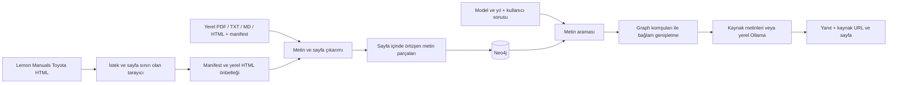
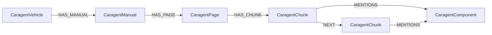

# CARAGENT mimarisi

## Hedef ve kapsam

Python 3.12 üzerinde Toyota kullanım/onarım kılavuzlarını Neo4j graph'a dönüştürmek ve seçilen araç için kaynak gösteren soru-cevap sunmak. Kaynak Lemon Manuals HTML sayfaları veya kullanıcı tarafından verilen PDF/TXT/MD/HTML dosyalarıdır. Başlangıç kaynağı Toyota Corolla LE 2024'tür; bütün Toyota arşivi otomatik olarak indirilmez.

## Veri akışı

## Graph modeli

`CaragentManual` bir belgeyi temsil eder: PDF içe aktarımında kitap, Lemon içe aktarımında bağımsız onarım makalesi. HTML makalesinin sayfa numarası 1'dir; bu basılı kitabın sayfası anlamına gelmez. PDF sayfası dosyanın 1'den başlayan fiziksel sayfa sırasıdır; basılı numarayla farklı olabilir. HTML başlığı, kaynak URL'si ve görsel URL'leri korunur. Diyagramlardaki metin OCR ile okunmaz.

Araç kimliği marka, tam model/donanım metni, model yılı ve pazar bilgisinden oluşur. Lemon'da pazar açıkça verilmediği için `Lemon dataset (market unspecified)` kaydedilir; Türkiye aracına uyumluluk iddiası yapılmaz. Model yılı 2024'teki bir makalenin içinde erken 2023 veya fabrika seçenekleri bulunabilir; metindeki koşullar cevabın parçasıdır.

Parça adları kontrollü Türkçe/İngilizce sözlük ile metinden çıkarılır. `MENTIONS`, yalnız adın geçtiğini belirtir; arıza, neden-sonuç, değiştirme gereği veya parça uyumluluğu belirtmez. Bu sürüm serbest ilişki çıkarımı için bir dil modeline ihtiyaç duymaz.

## İçe aktarma ve güncelleme

Kimlikler SHA-256 ile deterministik oluşturulur. Benzersizlik constraint'leri duplicate kayıtları engeller. Aynı belge içerik özeti değişmediyse atlanır. Değişen belgeye ait eski sayfa ve parçalar, yeni içerikle **tek belge transaction'ında** değiştirilir; başarısız işlem geri alınır. Manifestin tamamı önce doğrulanır; birden fazla belgeye ait işlemler belge bazında commit edilir. Kesinti sonrası komut tekrar çalıştırılır. İçe aktarılan bütün belgeler otomatik silinmez; tarama sınırlaması eski belgeleri kaldırmaz.

Tarayıcı `https://lemon-manuals.la/Toyota/<yıl>/<model>/` araç kökünü veya bunun altındaki belirli bir kılavuz dizinini kabul eder. `--all` araç kökü altındaki erişilebilir dizinleri kuyruk bitene kadar gezer; yinelenen toplu `Repair and Diagnosis (Single Page)` kopyası dışarıda bırakılır. Manifestteki `crawl.complete`, yalnız kuyruk hatasız tamamlandıysa `true` olur. robots.txt kontrol edilir; erişim engelinde tarama yapılmaz. Varsayılan tek bağlantıdır; 1–16 arası concurrency seçilebilir ve bütün worker'lar ortak istek aralığı sınırına uyar. İstek aralığı en az 0.5 saniyedir (varsayılan 1); robots.txt daha yüksek bir değer bildirirse o kullanılır. Sayfa/istek sınırı, süreli HTML önbelleği, timeout, sınırlı retry, üstel backoff ve ayrıntılı hata raporu vardır. Yönlendirmeler otomatik takip edilmez. Ağ kesintisinde son başarılı makaleye kadar manifest korunur; yeniden indirme başarısızsa var olan eski cache kontrollü olarak kullanılabilir ve raporlanır. Tarayıcının dosyaları ve manifestler yerel veridir, Git'e eklenmez.

Chunklama karakter, boşlukla ayrılmış token veya satır/paragraf birimiyle yapılabilir. Boyut ve overlap birimi seçilen stratejiye bağlıdır. Chunk profili içerik özetine katıldığı için ayar değişikliği aynı belgenin graph'ta yeniden oluşturulmasını tetikler. `benchmark-chunks` komutu üç varsayılan profili chunk sayısı, ortalama boyut, tahmini overlap ve isteğe bağlı retrieval proxy sorgularıyla karşılaştırır.

## GraphRAG yöntemi

1. Kullanıcı bir araç kimliği seçer. Diğer model/yıl/pazardaki metinler sonuçlara girmez.
2. Sorudan güvenli Lucene kelime sorgusu oluşturulur. Kullanıcının operatörleri yürütülmez. Yaygın Türkçe parça adları İngilizce terimlerle genişletilir.
3. Neo4j full-text index en ilgili metin parçalarını getirir. Soru tanınan bir parça hakkında ise ilk sonuçlarda o parça etiketinin bulunması gerekir; örneğin motor yağı aramasında yalnız `engine` kelimesinin geçtiği kamera hata kodları sonuçlara alınmaz.
4. `NEXT` ilişkileri ve ortak `MENTIONS` ilişkileri üzerinden en fazla iki ek parça getirilir. Bunlar aynı araçla sınırlandırılır ve soru terimlerinden en az birini içerir.
5. Kaynak ID, başlık, model/yıl/pazar, URL, sayfa ve eşleşme nedeni korunur.
6. Sohbet API'si önceki user/assistant turlarını alır. Takip soruları, en yakın kullanıcı konusu ile aramaya gönderilir. Modele sınırlı yakın konuşma geçmişi ve güncel kaynaklar birlikte aktarılır. Eski model yanıtları kaynak olarak kabul edilmez; kaynak numaraları her yanıtta yeniden atanır.
7. `sources` modu özgün alıntıları gösterir. `ollama` modu sohbet geçmişi ve güncel bağlamdan Türkçe yanıt üretir. Modelden JSON biçiminde yanıt metni ve kaynak numaraları alınır; numaralar güncel kaynak listesiyle doğrulanıp yanıta eklenir. Model erişilemiyorsa veya geçersiz kaynak numarası verirse sohbet içinde durum açıklanır; kaynaklar açılabilir halde korunur. Kaynak bulunmazsa model teknik bilgi üretmeden bir netleştirme sorusu soracak şekilde yönlendirilir.

Web arayüzü bir sohbet akışıdır. Mesajlar ve her mesajın kaynakları tarayıcının localStorage alanında tutulur. Yeni sohbet ve araç değişikliği geçmişi sıfırlar. Sunucu üzerinde kalıcı sohbet veritabanı bulunmaz.

Bu, full-text arama ile graph bağlam genişletmesi kullanan yerel GraphRAG'dır. Embedding/vector araması ve Microsoft GraphRAG community summary yöntemi bu sürümde yoktur. Türkçe sorgu genişletmesi sınırlı sözlüğe dayanır; kapsam dışı terimlerde İngilizce sorgu daha iyi sonuç verebilir. Dil modeli kaynak numaralarının varlığı doğrulanır; her iddianın kaynaktan çıktığı otomatik olarak ispatlanmaz. Başlangıç veri setinin küçük olması, başka konularda yanıt bulunamaması anlamına gelebilir.

## Bileşenler

| Dosya | Sorumluluk |
|---|---|
| `caragent/models.py` | Araç/belge/sayfa modelleri, kimlik, parça bölme, konu sözlüğü |
| `caragent/ingest.py` | Lemon tarama, manifest doğrulama, PDF/HTML metin çıkarma |
| `caragent/graph.py` | Neo4j şema, transaction, arama ve graph bağlamı |
| `caragent/rag.py` | Kaynaklı cevap, Ollama çağrısı ve geri dönüş |
| `caragent/api.py` | Yerel HTTP API ve girdi doğrulama |
| `caragent/cli.py` | Kurulum, veri aktarımı ve uygulama komutları |
| `caragent/web/index.html` | Araç seçimi, soru-cevap ve kaynak ekranı |
| `compose.yaml` | Neo4j ve isteğe bağlı Ollama servisleri |

## Çalışma sınırları

Web uygulaması ve Docker portları yalnız yerel bilgisayara bağlanır. Kullanıcı kimlik doğrulama sistemi bulunmaz; internete doğrudan yayınlamak için tasarlanmamıştır. Neo4j ve Ollama kalıcı Docker volume'leri kullanır. `.env` parolası ilk kurulumda üretilir, Git'e girmez; var olan Neo4j volume'ünün parolası `.env` değiştirildiğinde otomatik değişmez. Varsayılan Ollama konteyneri CPU kullanır; cevap süresi donanıma bağlıdır.

## Teknik kaynaklar

- [Neo4j Docker kurulumu](https://neo4j.com/docs/operations-manual/current/docker/introduction/)
- [Neo4j full-text index](https://neo4j.com/docs/cypher-manual/current/indexes/semantic-indexes/full-text-indexes/)
- [Neo4j Python transaction'ları](https://neo4j.com/docs/python-manual/current/transactions/)
- [Ollama chat API](https://docs.ollama.com/api/chat)
- [Ollama Docker](https://docs.ollama.com/docker)
- [Lemon Manuals Toyota](https://lemon-manuals.la/Toyota/)
