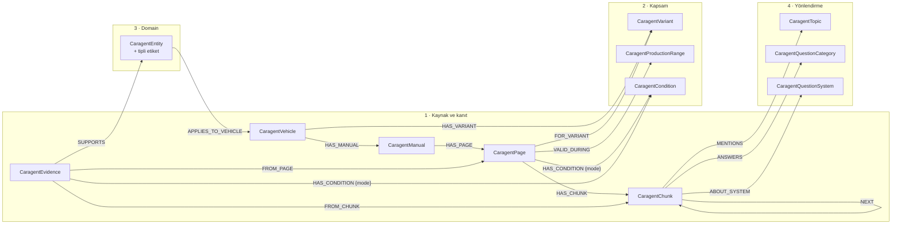
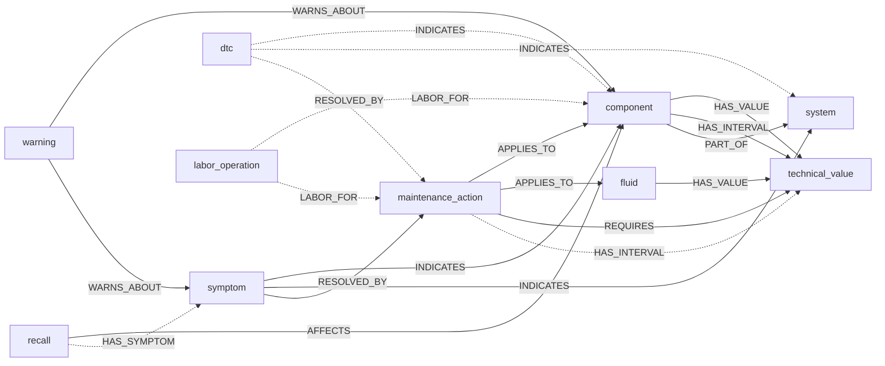

# CARAGENT Graph Şeması (CAR-6 → v3 tasarımı)

**Durum:** tasarım. Bu doküman kod içermez; uygulama ayrı bir görevde yapılacak.
**Girdi:** CAR-6, PR #2 — [user-question-research-v2.md](user-question-research-v2.md) (v2.2). Bu dokümandaki soru kimlikleri (N, L, BL, C) oradan gelir.
**Hedef araç:** 2024 Toyota Corolla LE, 2.0 L M20A-FKS, benzinli (yerel Lemon arşivi).
**Tarih:** 2026-11-20

---

## 1. Kapsam ve kısıtlar

### 1.1 Bugünkü durum (kod)

| Konu | Bugün | Kaynak |
|---|---|---|
| Neo4j | `neo4j:5.26-community`; eklenti yok (APOC/GDS yok) | `compose.yaml:4` |
| Arama | Yalnızca `caragent_chunks` fulltext indeksi var. Embedding ve vektör indeksi yok | `caragent/graph.py:104-106`, `docs/architecture.md:96` |
| Kimlikler | `stable_id(*parts)` ile SHA-256. Her etikette `id` UNIQUE | `caragent/models.py:7`, `caragent/graph.py:100-103` |
| Modeller | `@dataclass(frozen=True)` ve doğrulama için `__post_init__`. Pydantic kullanılmıyor | `caragent/models.py:32`, `:164` |
| Entity | `CaragentEntity` + tipli ikinci etiket; tür `type` property'sinde | `caragent/graph.py:17-22` |
| 9 entity türü | component, system, maintenance_action, warning, technical_value, feature, symptom, fluid, recall | `caragent/entity_extractor.py:21` |
| 9 domain ilişkisi | APPLIES_TO, HAS_VALUE, HAS_INTERVAL, WARNS_ABOUT, PART_OF, REQUIRES, INDICATES, RESOLVED_BY, AFFECTS | `caragent/entity_extractor.py:23-36` |
| Kanıt | `Chunk-[:SUPPORTS {page_id, page_number, source, quote}]->Entity`. İlişkilerde kanıt `evidence_json` metni olarak tutuluyor | `caragent/graph.py:396` |
| Test | Testler `tests/` altında düz dizilmiş. Entegrasyon testleri `CARAGENT_INTEGRATION=1` ile compose Neo4j üzerinde koşuyor | `tests/test_graph_integration.py:13-19` |

### 1.2 Bugünkü açıklar (bu tasarımın çözdüğü)

1. **Kapsam yok.** Üretim tarihi aralığı, donanım, fabrika, pazar ve kaynak türü (OM/R&D/LT/RC) kodda hiçbir yerde tutulmuyor. Varyant uyumsuzluğu yalnızca metin kalıbıyla yakalanıyor (`caragent/rag.py:115`).
2. **Breadcrumb atılıyor.** `parse_html` yalnızca `.main` içeriğini alıyor (`caragent/ingest.py:112-139`). Oysa tarih aralığı bazen yalnızca breadcrumb'da geçiyor. Örnek: `pages/30742.html` "… › Service Data [03/2023 - 08/2023] › M20A-FKS Engine Oil Standard Capacity".
3. **Yerel arşiv okunmuyor.** `crawl_lemon` yalnızca canlı siteyi tarıyor (`caragent/ingest.py:183-199`).
4. **Birim kalıbı Lemon biçimini kaçırıyor.** `VALUE_PATTERN` (`caragent/entity_extractor.py:100`) `107 N*m`, `79 ft.*lbf` ve `4.6 liters` değerlerini yakalamıyor (denendi). Bu doğrudan N19 ve L01'i etkiliyor.
5. **Idempotency açıkları:**
   - (a) Manual değişince Page/Chunk silinip yeniden yaratılıyor (`caragent/graph.py:150-151`). Entity'ler kalıyor ve kanıtları artık var olmayan chunk'ları gösterebiliyor.
   - (b) `SUPPORTS` anahtarsız MERGE ediliyor; aynı chunk+entity için alıntılar birbirinin üzerine yazılıyor.
   - (c) İlişki id'si `chunk.id` içeriyor (`caragent/entity_extractor.py:298`). Bu yüzden aynı olgu iki chunk'ta iki ayrı ilişki olarak yazılıyor.
6. **Yeni kavramlar için düğüm yok.** DTC, işçilik operasyonu, uyarı önem seviyesi ve recall–belirti bağı için modelleme yok (araştırma §4.2–§4.3).

### 1.3 Veri kısıtları (yerel Lemon arşivi)

- 87.544 HTML sayfa var. Bir HTML sayfa bir `CaragentManual` olarak yükleniyor (`caragent/ingest.py:305`). **PDF ve Owner's Manual (OM) yok.**
- **Labor Times ve Safety Recalls yalnızca *Corolla Hybrid LE, 1.8L Eng VIN C* için var** ("Other Variant"). LE için yerel işçilik ya da recall kaydı yok (araştırma §0B).
- Kapsam sayfa başlığında ve breadcrumb'da geçiyor:
  - `[03/2023 - 09/2024]`: üretim tarihi
  - `(Except 4-Pot Caliper)`: donanım, hariç
  - `(W/ Electric Parking Brake)`: donanım, yalnız bu
  - `(for TMC Made)`, `(TMC / TMMMS Made)`: fabrika
  - `(Except HEV)`, `(for Gasoline Model)`: güç aktarma
  - `(2023-25)`: model yılı
  - `External Pages › Different variant/trim` ve `other-variant` CSS sınıfı: başka varyant
- Satır düzeyinde de koşul var. Örnek: `pages/33298.html` Problem Symptoms Table'da "Rear axle hub (worn) (w/ Electric Parking Brake)".
- Aynı metin iki ağaçta ve farklı üretim aralıklarında tekrarlanıyor. 87.544 sayfada 24.579 benzersiz gövde metni var. **Tekilleştirmede tarih ve varyant bilgisi kaybolmamalı** (araştırma Ek A.10).
- Pazar: US ve Kanada; bazı sayfalar Meksika'ya özgü. EU/TR içeriği yok.

### 1.4 Teknik kısıtlar

- **Neo4j 5.26 Community:**
  - `IS NODE KEY`, property existence (`IS NOT NULL`) ve property type (`IS :: DATE`) kısıtları Enterprise'a özgü; **kullanılmaz**.
  - Tek property'li `id` UNIQUE kısıtı ve RANGE/FULLTEXT indeksler kullanılır.
  - Zorunlu alan ve tip denetimi Python'da (`__post_init__`) ve testlerdeki denetim (audit) sorgularıyla yapılır.
- **APOC yok.** İlişki türü dinamik verilemediği için her tür için ayrı sorgu çalışır (bugünkü yöntem, `caragent/graph.py:405`).
- **`SEARCH` sözdizimi yok.** Bu sözdizimi ve vektör araması Neo4j 2026.01+ gerektirir ve projede embedding yok. Örnekler `db.index.fulltext.queryNodes` ve graf gezinmesi kullanır.

---

## 2. Tasarım ilkeleri

1. **Geriye uyum.** Mevcut etiket, `id`, `type`, `NEXT`, `MENTIONS` ve diğer adlar korunur. Değişiklikler eklemeli yapılır. Tek kırıcı değişiklik `SUPPORTS` ilişkisinin başlangıç düğümünün Chunk yerine Evidence olmasıdır (bkz. §6).
2. **Kapsamın tek kaynağı sayfadır.** Tarih, donanım, fabrika, pazar ve varyant bilgisi `CaragentPage` üzerinde tutulur; satır düzeyindeki koşullar `CaragentEvidence` üzerinde tutulur. Bir olgunun kapsamı onu destekleyen kanıtlardan türetilir. Aynı bilgi olgu üzerinde ikinci kez saklanmaz.
3. **Kanıtsız olgu olmaz.** Her entity ve her domain ilişkisi en az bir `CaragentEvidence` ile desteklenir. Alıntı chunk metninin içinde birebir geçmek zorundadır.
4. **Yazımlar deterministiktir.** Bütün kimlikler `stable_id` ile üretilir ve bütün yazımlar `UNWIND … MERGE` ile yapılır. Aynı girdi iki kez yüklenince graf değişmez.
5. **Kapsam kararı üç durumludur.** Sonuç *uygun*, *çelişkili* ya da *bilinmiyor* olur. Çelişkili sonuç dışlanır. Bilinmeyen sonuç etiketlenerek gösterilir; adaylar arasında fark varsa tek bir netleştirme sorusu sorulur (araştırma S6, S9).
6. **Kaynak türü ve hedef kitle ayrılır.** Teknisyen prosedürü sürücü talimatı gibi sunulmaz. OM kaynağı yoksa cevap bunu açıkça söyler (araştırma Ek A.9).
7. **Recall uygunluğu kesinleştirilmez.** Graf "olası ilgili kayıt" gösterir; kesin sonucu yalnızca VIN sorgusu verir (araştırma S7).

---

## 3. Şema

### 3.1 Diyagram — katmanlar



### 3.2 Diyagram — domain katmanı (entity türleri arası)

Kesik çizgiler yeni ilişkileri ya da yeni uç noktaları gösterir.



Diyagram kısaltılmıştır. Uç noktaların tam listesi §3.5'tedir.

### 3.3 Düğümler

Tip gösterimi Neo4j tipidir: `STRING`, `INTEGER`, `FLOAT`, `BOOLEAN`, `DATE`, `DATETIME`, `LIST<STRING>`. "Zorunlu" alanlar Python'da doğrulanır ve testlerde denetim sorgusuyla kontrol edilir (§3.7).

| Etiket | Durum | Anahtar (`id` UNIQUE) | Zorunlu alanlar | İsteğe bağlı alanlar |
|---|---|---|---|---|
| `CaragentVehicle` | mevcut, değişmez | `stable_id("Toyota", model, year, market)` | `make`, `model`: STRING; `year`: INTEGER; `market`: STRING | — |
| `CaragentVariant` | **yeni** | `stable_id(vehicle_id, trim, engine_code, powertrain)` | `vehicle_id`, `label`, `trim`: STRING; `powertrain`: STRING (`ICE` / `HEV`); `is_target`: BOOLEAN | `engine_code`, `transmission`, `body`, `lemon_variant_text`: STRING |
| `CaragentManual` | **genişler** | mevcut | mevcut alanlar + `source_type`: STRING (`OM` / `R&D` / `LT` / `RC` / `TSB`); `other_variant`: BOOLEAN | `section_path`: STRING |
| `CaragentPage` | **genişler** | mevcut | mevcut alanlar + `section_path`: STRING; `other_variant`: BOOLEAN; `scope_conflict`: BOOLEAN | `range_labels`: LIST&lt;STRING&gt;; `model_year_from`, `model_year_to`: INTEGER; `alias_numbers`: LIST&lt;INTEGER&gt; |
| `CaragentChunk` | **genişler** | mevcut | mevcut alanlar + `page_id`, `content_hash`, `source_type`: STRING; `page_number`: INTEGER; `other_variant`: BOOLEAN | `valid_from`, `valid_to`: DATE (sayfadan kopya; fulltext sonrası hızlı filtre için) |
| `CaragentEvidence` | **yeni** | `stable_id(page_id, quote_hash)` | `quote`, `quote_hash`, `page_id`, `chunk_id`, `source_type`, `extractor`, `extractor_version`: STRING; `page_number`: INTEGER; `created_at`: DATETIME | `source_url`: STRING; `char_start`, `char_end`, `rank`: INTEGER; `table_title`: STRING |
| `CaragentProductionRange` | **yeni** | `stable_id("production-range", start_date, end_date)` | `raw_label`: STRING; `start_date`: DATE | `end_date`: DATE (null ise açık uçlu) |
| `CaragentCondition` | **yeni** | `stable_id("condition", key)` | `key`, `kind`, `code`, `label`: STRING | `raw_examples`: LIST&lt;STRING&gt; |
| `CaragentEntity` | **genişler** | mevcut: `stable_id(vehicle_id, type, normalized_name)`; istisnalar §3.4'te | mevcut alanlar (`type`, `name`, `normalized_name`, `vehicle_id`, `confidence`, `status`, `systems`, …) | türe özgü property'ler §3.4'te |
| `CaragentTopic` | mevcut | mevcut | `name` | — |
| `CaragentQuestionCategory` | mevcut | mevcut | `title`, `priority` | — |
| `CaragentQuestionSystem` | **değerler genişler** | mevcut | `name` | Yeni değerler: `suspension`, `body`, `hybrid_system`, `fuel` (araştırma Ek A.2, :626) |

**Alanlara ilişkin notlar:**
- `source_type` değerleri araştırmadaki dört türdür (OM, R&D, LT, RC; araştırma :206). Lemon'daki *Technical Bulletins › TSBs* bölümü için `TSB` eklenir. OM şimdilik boştur; ileride OM kaynağı eklenirse kullanılacak.
- `content_hash` = `sha256(normalize(text))`. Normalizasyon yalnızca boşluk/satır sonu ve Unicode NFC'dir. Büyük/küçük harf ve rakamlar korunur. Bu alan **unique değildir**: aynı metin farklı kapsamlı sayfalarda bulunabilir.
- `alias_numbers`: kapsamı ve metni birebir aynı olan kopya sayfaların numaraları (ör. iki ağaçtaki aynı sayfa). Bu kopyalar için ayrı Page yaratılmaz (§3.9).
- `Evidence.chunk_id`: alıntının ofsetlerinin (`char_start`/`char_end`) geçerli olduğu chunk. Alıntı chunk örtüşmesi nedeniyle iki chunk'ta geçiyorsa en küçük `page_ordinal` seçilir. Kaynak gerçeği `FROM_CHUNK` kenarlarıdır; bunlardan birden fazla olabilir.
- `Evidence.rank`: alıntı sıralı bir tablonun satırıysa (ör. Problem Symptoms Table) o satırın sırası.
- `Condition.key` = `kind:code` (ör. `hardware:EPB`).
  - `kind` değerleri: `hardware`, `plant`, `market`, `engine`, `powertrain`, `transmission`, `body`.
  - Başlangıç sözlüğü: `hardware:EPB`, `hardware:CALIPER_4POT`, `hardware:TPMS_TYPE_B`, `plant:TMC`, `plant:TMMMS`, `market:MX`, `powertrain:HEV`, `powertrain:ICE`, `engine:M20A-FKS`, `engine:G16E-GTS`, `engine:2ZR-FXE`, `engine:2ZR-FAE`, `body:HATCHBACK`.
  - Sözlüğün tamamı arşiv taramasıyla kesinleşecek (§8).

**Başlangıç varyantları:**

| `label` | `is_target` | Not |
|---|---|---|
| 2024 Corolla LE 2.0L M20A-FKS | true | `powertrain=ICE`, `engine_code=M20A-FKS`, `body=SEDAN` |
| Corolla Hybrid LE, 1.8L Eng VIN C | false | `powertrain=HEV`; Lemon'daki LT ve RC sayfalarının varyantı |

### 3.4 Entity türleri ve türe özgü alanlar

Mevcut 9 türe 2 tür eklenir. Filtrelemede kullanılan alanlar `attributes_json` içinden gerçek property'ye taşınır; geri kalanlar JSON'da kalabilir.

| Tür | Tipli etiket | Durum | Türe özgü alanlar | Kimlik |
|---|---|---|---|---|
| component | `CaragentComponentEntity` | mevcut | — (bağlantı noktaları da component sayılır: "Front disc brake cylinder mounting x Steering knuckle") | mevcut |
| system | `CaragentSystemEntity` | mevcut | — | mevcut |
| fluid | `CaragentFluidEntity` | mevcut | — | mevcut |
| feature | `CaragentFeatureEntity` | mevcut | — | mevcut |
| maintenance_action | `CaragentMaintenanceAction` | **genişler** | `steps`: LIST&lt;STRING&gt; (sıralı); `preconditions`: LIST&lt;STRING&gt; (ör. "motor sıcak") | mevcut |
| technical_value | `CaragentTechnicalValue` | **genişler** | **zorunlu:** `quantity` (`capacity` / `torque` / `pressure` / `interval` / `dimension` / `other`) ve `raw_value` (STRING); **isteğe bağlı:** `value_min`, `value_max` (FLOAT), `unit` (STRING, kaynaktaki birim), `qualifier` (ör. "with oil filter change"), `subject_id` | **değişir:** `stable_id(vehicle_id, "technical_value", subject_normalized, quantity, normalize(raw_value), qualifier)`. Böylece yağın 4,6 L'si ile soğutma sıvısının 4,6 L'si ayrı düğüm olur |
| warning | `CaragentWarningEntity` | **genişler** | `signal_word` (`WARNING` / `CAUTION` / `NOTICE` / `HINT` / `NONE`); `severity` (`stop_now` / `service_soon` / `info`); `action`: STRING; `audience` (`driver` / `technician`) | mevcut |
| symptom | `CaragentSymptomEntity` | **genişler** | `sound` (`squeak` / `squeal` / `click` / `clunk` / `rattle` / `grind` / `hum` / null); `trigger`: LIST&lt;STRING&gt; (`braking`, `turning`, `parking`, `bump`, `cold_start`, `driving`, `idle`); `location` (`front` / `rear` / `left` / `right` / `steering` / null) | mevcut |
| recall | `CaragentRecallEntity` | **genişler** | **zorunlu:** `nhtsa_id` (ör. 24V878000), `requires_vin_check` (her zaman `true`); **isteğe bağlı:** `manufacturer_id` (ör. 24TA13), `component_text` | `stable_id(vehicle_id, "recall", nhtsa_id)` |
| dtc | `CaragentDtcEntity` | **yeni** | **zorunlu:** `code` (ör. P0171); **isteğe bağlı:** `suffix` (ör. 00), `description` | `stable_id(vehicle_id, "dtc", code, suffix)` |
| labor_operation | `CaragentLaborOperation` | **yeni** | **zorunlu:** `operation_name`, `labor_hours` (FLOAT); **isteğe bağlı:** `scope_note` | `stable_id(vehicle_id, "labor_operation", normalized_name)` |

**Değerlerin nereden geldiği:**
- `severity` ve `audience` kaynak türünden ve metinden kural tabanlı çıkarılır. OM ve RC kaynaklıysa `audience=driver`; R&D, LT ve TSB kaynaklıysa `technician`.
- ISO 26262 ASIL gibi kaynakta bulunmayan sınıflar **tutulmaz**.
- Türkçe ses adları sorgu tarafında eşlenir. Örnek: "gıcırtı" → `squeak`/`squeal`, "tık" → `click`.

### 3.5 İlişkiler

**Kaynak, kapsam ve kanıt katmanı**

| Tür | Yön | Özellikler | Durum |
|---|---|---|---|
| `HAS_MANUAL` | Vehicle → Manual | — | mevcut |
| `HAS_PAGE` | Manual → Page | — | mevcut |
| `HAS_CHUNK` | Page → Chunk | — | mevcut |
| `NEXT` | Chunk → Chunk | — | mevcut (aynı sayfa içinde) |
| `MENTIONS`, `ANSWERS`, `ABOUT_SYSTEM` | Chunk → Topic / QuestionCategory / QuestionSystem | — | mevcut |
| `APPLIES_TO_VEHICLE` | Entity → Vehicle | — | mevcut |
| `HAS_VARIANT` | Vehicle → Variant | — | **yeni** |
| `FOR_VARIANT` | Page → Variant | — | **yeni**; yalnızca sayfa başka bir varyanta aitse ve varyant metinden tanınıyorsa yazılır |
| `VALID_DURING` | Page → ProductionRange | — | **yeni**; sayfa başına en fazla bir kenar (etkin aralık, §3.6) |
| `HAS_CONDITION` | Page → Condition, Evidence → Condition | `mode`: STRING (`only` / `except`), zorunlu | **yeni** |
| `FROM_PAGE` | Evidence → Page | — | **yeni**; tam olarak bir kenar |
| `FROM_CHUNK` | Evidence → Chunk | — | **yeni**; bir ya da daha fazla kenar |
| `SUPPORTS` | **Evidence → Entity** | — | **değişir**: eskiden Chunk → Entity idi ve alıntı ilişki üzerinde tutuluyordu |

**Domain katmanı.** Bütün domain ilişkileri Entity → Entity yönündedir ve şu özellikleri taşır:
- `id` = `stable_id(vehicle_id, type, source_id, target_id)`. **Chunk artık id'ye girmez.**
- `confidence`: FLOAT; `status` (`verified` / `needs_review`); `updated_at`: DATETIME; `properties_json`: STRING.
- `evidence_ids`: LIST&lt;STRING&gt;; zorunlu ve en az 1 eleman. Bu alan `evidence_json`'ın yerini alır.

Neo4j bir kenarı bir düğüme bağlayamadığı için ilişki kanıtı `evidence_ids` ile tutulur.

| Tür | Kaynak türü → hedef türü | Durum |
|---|---|---|
| `APPLIES_TO` | maintenance_action → component, fluid, system, feature | mevcut |
| `HAS_VALUE` | component, fluid, system → technical_value | mevcut |
| `HAS_INTERVAL` | component, fluid, system, **maintenance_action** → technical_value | uç nokta genişler (araştırma §4.3 "bakım işlemi → aralık") |
| `WARNS_ABOUT` | warning → component, fluid, system, feature, symptom | mevcut |
| `PART_OF` | component → system | mevcut |
| `REQUIRES` | maintenance_action → technical_value | mevcut |
| `INDICATES` | symptom, **dtc** → component, system | uç nokta genişler. Sıra bilgisi kanıtta (`Evidence.rank`) tutulur, çünkü aynı neden farklı tarih aralığındaki tablolarda farklı sırada olabilir |
| `RESOLVED_BY` | symptom, **dtc** → maintenance_action | uç nokta genişler |
| `AFFECTS` | recall → component, system | mevcut |
| `HAS_SYMPTOM` | recall → symptom | **yeni**; recall kaydında erken belirti yazıyorsa |
| `LABOR_FOR` | labor_operation → component, maintenance_action | **yeni** |

Uç nokta kuralları `RELATIONSHIP_ENDPOINTS` içinde tanımlanır (`caragent/entity_extractor.py:26`). Ters yönlü ya da izinsiz bir uç nokta çıkarımda reddedilir ve graf denetiminde ihlal sayılır (§3.7, A3).

### 3.6 Kapsam kuralları

**Üretim tarihi**
- Ayrıştırma:
  - `[MM/YYYY - MM/YYYY]` → `start_date` = başlangıç ayının 1'i, `end_date` = bitiş ayının son günü.
  - `[MM/YYYY - ]` → `end_date = null` (açık uç).
  - Biçim dışı etiket → `ValueError`.
- Etkin aralık:
  - Başlıktaki ve breadcrumb'daki bütün aralıkların **kesişimi** alınır.
  - Kesişim boşsa en içteki etiket (sayfaya en yakın olan) kullanılır, `Page.scope_conflict = true` yapılır ve ingest raporuna uyarı yazılır.
- Kullanıcının üretim ayı `M` için eşleşme koşulu: `start_date ≤ son_gün(M)` ve (`end_date` null ya da `end_date ≥ ilk_gün(M)`).
- **Sınır ayı:** Lemon aralıkları uçlarda örtüşür. Örnek: `[03/2023 - 08/2023]` ve `[08/2023 - 09/2024]`. 08/2023 üretimi iki aralığa da uyar; iki değer birlikte gösterilir ve bunun bir sınır ayı olduğu belirtilir.
- Üretim ayı bilinmiyorsa:
  - Filtre uygulanmaz ve sonuçlar aralığa göre gruplanır.
  - Aralıklar farklı değer veriyorsa bir netleştirme sorusu sorulur: "Kapı direğindeki etikette üretim ayı/yılı nedir?"
- Model yılı etiketi `(2023-25)` → `model_year_from`/`model_year_to`. Aracın yılı bu aralığın dışındaysa çelişkili sayılır.

**Koşullar (`ScopeMatcher`, Python)**

Kullanıcı profili koşulları iki kümeye ayırır: `present` (araçta olduğu bilinen) ve `absent` (araçta olmadığı bilinen). Bu iki kümede de bulunmayan koşul **bilinmiyor** sayılır.
- Varyanttan türetilen koşullar her zaman bilinir. Hedef LE için:
  - `present`: `engine:M20A-FKS`, `powertrain:ICE`, `body:SEDAN`
  - `absent`: diğer motor kodları, `powertrain:HEV`, `body:HATCHBACK`
- Her `kind` ayrı değerlendirilir:
  - **`only` koşulları VEYA ile birleşir.** Örnek: "(TMC / TMMMS Made)" iki `only` koşulu üretir. Hepsi `absent` ise sonuç *çelişkili*, en az biri `present` ise *uygun*, diğer durumlarda *bilinmiyor*.
  - **`except` koşulları VE ile birleşir.** Biri `present` ise sonuç *çelişkili*. Hepsi `absent` ise *uygun*, diğer durumlarda *bilinmiyor*.
- Kanıtın kapsamı = sayfa koşulları ∪ satır koşulları (`Evidence-[:HAS_CONDITION]`).
- Sonuç değerleri:
  - `match`
  - `unknown` (açık koşullarla birlikte döner)
  - `conflict` (cevaptan dışlanır)
  - `other_variant` (aşağıya bakın)

**Başka varyant**
- `Page.other_variant = true` olan kanıt **LE olgusu gibi sunulmaz**. Cevapta yalnızca "başka varyant kaydı (Corolla Hybrid LE)" etiketiyle gösterilebilir. Örnekler: N07 (recall), N23 (işçilik).
- Başka varyant kaydı "LE'yi kapsamaz" anlamına da gelmez. Örneğin NHTSA kaydına göre 24V878000 hem 2023–2024 Corolla'yı hem Corolla Hybrid'i kapsar ([NHTSA/Justia 24V878](https://auto-recalls.justia.com/toyota/corolla/2024/24v878000)). Kesin sonucu VIN sorgusu verir.

**VIN**
- VIN'den yalnızca iki ipucu çıkarılır:
  - **Fabrika:** WMI `5YF` → `plant:TMMMS`; `JT` ile başlıyorsa → `plant:TMC`. Diğer WMI'lar bilinmiyor sayılır.
  - **Model yılı:** 10. karakter; P=2023, R=2024, S=2025.
- Bu eşleme arşivde bir kaynakla kanıtlanana kadar cevapta "kaynak dışı ipucu" olarak etiketlenir.
- VIN ile recall uygunluğu belirlenmez.

**Çelişen kaynakların önceliği**

| Soru tipi | Öncelikli kaynak | Kaynak yoksa |
|---|---|---|
| Recall ve kampanya | RC | "Yerel kayıt yok", VIN sorgu kanalı verilir |
| Teknik değer, tork, DTC, teşhis adımı | R&D | Soru cevapsız bırakılır (abstain) |
| Sürücü eylemi ("sürebilir miyim?", "durmalı mıyım?") | OM | **OM'nin olmadığı açıkça söylenir.** R&D bilgisi teknisyen içeriği olarak etiketlenir |
| İşçilik süresi | LT | "LE için işçilik kaydı yok" denir. Hybrid LE kaydı etiketli gösterilebilir |

### 3.7 Kanıt sözleşmesi ve denetim sorguları

**Kanıt kuralları**
- `Evidence.quote`, `chunk.text` içinde **birebir** geçmelidir. Karşılaştırma `normalize()` sonrası yapılır ve büyük/küçük harfe duyarlıdır. Bugünkü `_mentioned` kontrolü casefold yapıyor (`caragent/entity_extractor.py:208`); bu kural sıkılaştırılır.
- `char_start`/`char_end` aynı chunk içindeki konumdur.
- Kanıt doğrulamasından geçmeyen olgu grafa yazılmaz. Bu kural bugün de geçerli; reddedilen olgu `ExtractionResult.warnings` alanına düşüyor.

**Denetim sorguları.** Integration testlerinde çalışır; hepsinin sonucu 0 olmalıdır.

```cypher
// A1 — kanıtsız entity
MATCH (e:CaragentEntity {vehicle_id: $vehicle_id})
WHERE NOT EXISTS { MATCH (:CaragentEvidence)-[:SUPPORTS]->(e) }
RETURN count(e) AS facts_without_evidence;

// A2 — kanıtsız ya da kırık kanıt id'li ilişki
MATCH (:CaragentEntity {vehicle_id: $vehicle_id})-[r]->(:CaragentEntity)
WITH r, coalesce(r.evidence_ids, []) AS ids
WITH r, ids, [id IN ids WHERE NOT EXISTS { MATCH (:CaragentEvidence {id: id}) }] AS missing
WHERE size(ids) = 0 OR size(missing) > 0
RETURN type(r) AS rel_type, count(r) AS broken;

// A3 — yön ve uç nokta ihlali ($allowed_endpoints: RELATIONSHIP_ENDPOINTS'ten üretilen
//      [{rel:'INDICATES', src:'dtc', dst:'component'}, ...] listesi)
MATCH (a:CaragentEntity {vehicle_id: $vehicle_id})-[r]->(b:CaragentEntity)
WITH type(r) AS rel, a.type AS src, b.type AS dst
WHERE NOT {rel: rel, src: src, dst: dst} IN $allowed_endpoints
RETURN rel, src, dst, count(*) AS violations;

// A4 — chunk metninde birebir geçmeyen alıntı
MATCH (ev:CaragentEvidence)-[:FROM_CHUNK]->(c:CaragentChunk)
WHERE NOT c.text CONTAINS ev.quote
RETURN count(ev) AS ungrounded_quotes;

// A5 — zorunlu alanı eksik ya da geçersiz kanıt
MATCH (ev:CaragentEvidence)
WHERE ev.quote IS NULL OR ev.page_id IS NULL OR ev.page_number IS NULL
   OR NOT ev.source_type IN ['OM', 'R&D', 'LT', 'RC', 'TSB']
   OR NOT EXISTS { MATCH (ev)-[:FROM_PAGE]->(:CaragentPage) }
RETURN count(ev) AS invalid_evidence;
```

### 3.8 Kısıtlar ve indeksler (Neo4j 5.26 Community)

Mevcut 8 `id` UNIQUE kısıtı ve `caragent_chunks` fulltext indeksi korunur. Eklenecekler (hepsi `IF NOT EXISTS` ile idempotent):

```cypher
CREATE CONSTRAINT caragent_variant_id IF NOT EXISTS
  FOR (n:CaragentVariant) REQUIRE n.id IS UNIQUE;
CREATE CONSTRAINT caragent_evidence_id IF NOT EXISTS
  FOR (n:CaragentEvidence) REQUIRE n.id IS UNIQUE;
CREATE CONSTRAINT caragent_productionrange_id IF NOT EXISTS
  FOR (n:CaragentProductionRange) REQUIRE n.id IS UNIQUE;
CREATE CONSTRAINT caragent_condition_id IF NOT EXISTS
  FOR (n:CaragentCondition) REQUIRE n.id IS UNIQUE;

CREATE INDEX caragent_chunk_content_hash IF NOT EXISTS
  FOR (c:CaragentChunk) ON (c.content_hash);
CREATE INDEX caragent_range_dates IF NOT EXISTS
  FOR (r:CaragentProductionRange) ON (r.start_date, r.end_date);
CREATE INDEX caragent_condition_key IF NOT EXISTS
  FOR (c:CaragentCondition) ON (c.key);
CREATE INDEX caragent_entity_type_name IF NOT EXISTS
  FOR (e:CaragentEntity) ON (e.type, e.normalized_name);
CREATE INDEX caragent_dtc_code IF NOT EXISTS
  FOR (d:CaragentDtcEntity) ON (d.code);
CREATE INDEX caragent_evidence_page IF NOT EXISTS
  FOR (e:CaragentEvidence) ON (e.page_id);
```

`NODE KEY`, `IS NOT NULL` ve `IS :: <TYPE>` kullanılmaz (Enterprise'a özgü). Birleşik kimlik gereken her yerde (ör. entity'nin ad + tür + kapsam üçlüsü) bu parçalardan `stable_id` üretilir ve tek bir `id` UNIQUE kısıtı yeterli olur.

### 3.9 Tekilleştirme ve idempotency

**Sayfa tekilleştirme (arşiv okuyucusu)**
- Önce **kapsam imzası** hesaplanır: `stable_id(content_hash, etkin_aralık_id, sıralı koşul anahtarları, other_variant, variant_id)`.
- Aynı imzaya sahip sayfalar tek bir Page olarak yazılır; diğer sayfa numaraları `alias_numbers` alanına eklenir. Örnek: iki ağaçtaki birebir aynı sayfa.
- Metni aynı ama kapsamı farklı sayfalar **ayrı kalır**. Örnek: aynı tablonun `[11/2022 - 09/2024]` ve `[09/2024 - ]` kopyaları. Bu, Ek A.10'daki "tarih ve varyant kaybolmamalı" şartını karşılar.

**Çıkarım önbelleği**
- `extract_chunks`, `content_hash` başına bir kez çıkarım yapar (kural tabanlı ya da LLM).
- Aynı metnin diğer kopyalarında sonuç kopyalanır ve kanıtlar her sayfa için **yeniden bağlanır**: yeni `page_id` ile yeni Evidence id'si üretilir. LLM çağrısı tekrarlanmaz.

**Yazım ve temizlik**

| # | Değişmez kural | Nasıl sağlanır |
|---|---|---|
| I1 | Aynı manifest ve extraction iki kez yüklenince düğüm/ilişki sayıları ve property değerleri aynı kalır (`updated_at` hariç) | Bütün yazımlar `MERGE` ile yapılır, id'ler `stable_id` ile üretilir. Page ve Chunk için `CREATE` yerine `MERGE` kullanılır. `evidence_ids` sıra korunarak birleştirilir (aşağıdaki sorgu) |
| I2 | Aynı metin farklı kapsamlı iki sayfada → 1 çıkarım, 2 Evidence, 2 farklı aralık | Kapsam imzası ve çıkarım önbelleği |
| I3 | Aynı olgu iki chunk'ta → 1 ilişki, `evidence_ids` içinde 2 id | İlişki id'sinde chunk yok |
| I4 | Manual değişince ya da silinince o manual'a ait Evidence'lar silinir. Kanıtı kalmayan ilişki ve entity de silinir | `_prune_manual_evidence` (aşağıda), Page/Chunk silinmeden **önce** çalışır |
| I5 | Aynı alıntı aynı sayfada → tek Evidence | `Evidence.id = stable_id(page_id, quote_hash)` |

```cypher
// Yazım: kanıt (UNWIND + MERGE)
UNWIND $evidence AS row
MERGE (ev:CaragentEvidence {id: row.id})
  ON CREATE SET ev.created_at = datetime()
SET ev.quote = row.quote, ev.quote_hash = row.quote_hash,
    ev.page_id = row.page_id, ev.chunk_id = row.chunk_id,
    ev.page_number = row.page_number, ev.source_type = row.source_type,
    ev.source_url = row.source_url, ev.extractor = row.extractor,
    ev.extractor_version = row.extractor_version,
    ev.char_start = row.char_start, ev.char_end = row.char_end, ev.rank = row.rank
WITH ev, row
MATCH (pg:CaragentPage {id: row.page_id})
MATCH (c:CaragentChunk {id: row.chunk_id})
MERGE (ev)-[:FROM_PAGE]->(pg)
MERGE (ev)-[:FROM_CHUNK]->(c);

// Yazım: domain ilişkisi (her tür için ayrı sorgu; INDICATES örneği)
UNWIND $relationships AS row
MATCH (a:CaragentEntity {id: row.source_id})
MATCH (b:CaragentEntity {id: row.target_id})
MERGE (a)-[r:INDICATES {id: row.id}]->(b)
SET r.confidence = row.confidence, r.status = row.status, r.updated_at = datetime(),
    r.evidence_ids = reduce(acc = [], x IN coalesce(r.evidence_ids, []) + row.evidence_ids |
                            CASE WHEN x IN acc THEN acc ELSE acc + x END);

// Yazım: sayfa kapsamı
UNWIND $pages AS row
MATCH (pg:CaragentPage {id: row.id})
FOREACH (r IN row.ranges |
  MERGE (pr:CaragentProductionRange {id: r.id})
    ON CREATE SET pr.raw_label = r.raw_label,
                  pr.start_date = date(r.start_date), pr.end_date = date(r.end_date)
  MERGE (pg)-[:VALID_DURING]->(pr))
FOREACH (c IN row.conditions |
  MERGE (cond:CaragentCondition {id: c.id})
    ON CREATE SET cond.key = c.key, cond.kind = c.kind, cond.code = c.code, cond.label = c.label
  MERGE (pg)-[:HAS_CONDITION {mode: c.mode}]->(cond));
```

`date(null)` null döndürdüğü için açık uçlu aralıkta `end_date` null kalır.

**Temizlik (`_prune_manual_evidence`).** Manual değiştiğinde aynı transaction içinde, Page/Chunk silinmeden önce şu sırayla çalışır:

```cypher
// 1. Bu manual'a ait kanıt id'lerini topla
MATCH (ev:CaragentEvidence)-[:FROM_PAGE]->(:CaragentPage {manual_id: $manual_id})
RETURN collect(ev.id) AS dead_ids;

// 2. Kanıtları sil
MATCH (ev:CaragentEvidence) WHERE ev.id IN $dead_ids
DETACH DELETE ev;

// 3. İlişkilerden ölü id'leri çıkar; boş kalan ilişkiyi sil
MATCH (:CaragentEntity)-[r]->(:CaragentEntity)
WHERE any(id IN r.evidence_ids WHERE id IN $dead_ids)
SET r.evidence_ids = [id IN r.evidence_ids WHERE NOT id IN $dead_ids]
WITH r WHERE size(r.evidence_ids) = 0
DELETE r;

// 4. Kanıtı kalmayan entity'yi sil
MATCH (e:CaragentEntity {vehicle_id: $vehicle_id})
WHERE NOT EXISTS { MATCH (:CaragentEvidence)-[:SUPPORTS]->(e) }
DETACH DELETE e;
```

---

## 4. Örnek sorular ve graf sorguları

**Ortak parametreler:**
- `$vehicle_id`
- `$build_from`, `$build_to`: kullanıcının üretim ayının ilk ve son günü (`'YYYY-MM-DD'`). İkisi de `null` olabilir (bilinmiyor).

**Ortak tarih bloğu.** Kapsamı tarihe bağlı sorgular (Q1, Q2, Q3, Q6) aynı `CASE` bloğunu içerir: `date_status` değeri `any` (sayfada aralık yok), `match`, `unknown` ya da `conflict` olur ve `conflict` satırları elenir. Recall ve uyarı sorguları (Q4, Q5, Q7) tarih filtresi uygulamaz.

**Koşullar.** `conditions` sütunu ham döner; koşul kararını Python'daki `ScopeMatcher` verir (§3.6).

**Arama sırası.** Graf sorgusundan önce mevcut fulltext araması (`caragent/graph.py:596`) çalışır ve entity adayları bulunur. Aşağıdaki sorgular bu adaylardan sonraki graf gezinmesidir.

> **Doğrulama notu:** Sorgular Neo4j 5.26 sözdizimine göre yazıldı (`COLLECT {}` / `COUNT {}` alt sorguları 5.x'te mevcut). Yazıldıkları tarihte (2026-11-20) Neo4j çalışmadığı için **`EXPLAIN` ile denenmedi**. Uygulamada §7'deki `test_example_queries_*` testleri her sorguyu fixture graf üzerinde çalıştırır.

### Q1 — L01: "Aracım 08/2023'ten önce üretildiyse motor yağı kapasitesi farklı mı?"
**Senaryo:** S3 + üretim tarihi. **Kaynak:** `pages/30742.html` [03/2023 - 08/2023], `pages/30761.html` [08/2023 - 09/2024].

```cypher
MATCH (oil:CaragentFluidEntity {vehicle_id: $vehicle_id, normalized_name: 'engine oil'})
      -[hv:HAS_VALUE]->(val:CaragentTechnicalValue {quantity: 'capacity'})
UNWIND hv.evidence_ids AS ev_id
MATCH (ev:CaragentEvidence {id: ev_id})-[:FROM_PAGE]->(pg:CaragentPage)
WHERE NOT pg.other_variant
OPTIONAL MATCH (pg)-[:VALID_DURING]->(pr:CaragentProductionRange)
WITH val, ev, pr,
     CASE
       WHEN pr IS NULL THEN 'any'
       WHEN $build_from IS NULL THEN 'unknown'
       WHEN pr.start_date <= date($build_to)
            AND (pr.end_date IS NULL OR pr.end_date >= date($build_from)) THEN 'match'
       ELSE 'conflict'
     END AS date_status
WHERE date_status <> 'conflict'
RETURN val.qualifier AS condition, val.value_min AS value, val.unit AS unit,
       val.raw_value AS raw_value, pr.raw_label AS production_range,
       pr.start_date AS range_start, date_status,
       ev.quote AS quote, ev.page_number AS page, ev.source_type AS source_type
ORDER BY range_start, condition;
```

**Beklenen:**
- Soru iki dönemi karşılaştırdığı için tarih filtresi uygulanmaz (`$build_from = null`).
- [03/2023 - 08/2023] aralığında "with oil filter change" için 4,6 L (4,9 US qt) döner.
- [08/2023 - 09/2024] aralığında 4,2 L (4,4 US qt) döner.
- Cevap 08/2023'ün iki aralıkta da yer aldığını (sınır ayı) söyler.
- Her satırda alıntı, sayfa numarası ve `R&D` kaynak türü bulunur.

### Q2 — N13: "P0171 arıza kodu ne anlama gelir ve hangi parçalar kontrol edilmelidir?"
**Senaryo:** S2 (DTC). **Kaynak:** `pages/17295.html` (Description) ve `pages/17303.html` (Procedure). Üç aralık var: [11/2022 - 03/2023], [03/2023 - 09/2024], [09/2024 - ].

```cypher
MATCH (dtc:CaragentDtcEntity {vehicle_id: $vehicle_id, code: $code})
      -[ind:INDICATES]->(area:CaragentEntity)
UNWIND ind.evidence_ids AS ev_id
MATCH (ev:CaragentEvidence {id: ev_id})-[:FROM_PAGE]->(pg:CaragentPage)
WHERE NOT pg.other_variant
OPTIONAL MATCH (pg)-[:VALID_DURING]->(pr:CaragentProductionRange)
WITH dtc, area, ev, pr,
     CASE
       WHEN pr IS NULL THEN 'any'
       WHEN $build_from IS NULL THEN 'unknown'
       WHEN pr.start_date <= date($build_to)
            AND (pr.end_date IS NULL OR pr.end_date >= date($build_from)) THEN 'match'
       ELSE 'conflict'
     END AS date_status
WHERE date_status <> 'conflict'
RETURN dtc.code AS code, dtc.suffix AS suffix, dtc.description AS description,
       area.name AS suspected_area, ev.rank AS rank,
       pr.raw_label AS production_range, date_status,
       ev.quote AS quote, ev.page_number AS page
ORDER BY production_range, rank;
```

**Beklenen:**
- Açıklama "System Too Lean Bank 1" ve olası neden alanları döner. Tablo sıralıysa `rank` sırasıyla, değilse `rank` null olarak listelenir.
- Cevap nedenleri "kesin değil" ibaresiyle verir (S2).
- Teşhis adımları aynı kalıpla `RESOLVED_BY` (dtc → maintenance_action) üzerinden alınır.
- Üretim ayı bilinmiyorsa üç aralık gruplanarak gösterilir.

### Q3 — N19: "Fren kaliper braket cıvataları kaç Nm ile sıkılmalıdır?"
**Senaryo:** S3 + donanım koşulu. **Kaynak:** `pages/10780.html` "Front Brake (Except 4-Pot Caliper)", [09/2022 - ].

```cypher
// $part_terms: sorgu normalizasyonu, ör. ['disc brake cylinder mounting', 'steering knuckle']
MATCH (joint:CaragentComponentEntity {vehicle_id: $vehicle_id})
      -[hv:HAS_VALUE]->(val:CaragentTechnicalValue {quantity: 'torque'})
WHERE all(term IN $part_terms WHERE joint.normalized_name CONTAINS term)
UNWIND hv.evidence_ids AS ev_id
MATCH (ev:CaragentEvidence {id: ev_id})-[:FROM_PAGE]->(pg:CaragentPage)
WHERE NOT pg.other_variant
OPTIONAL MATCH (pg)-[:VALID_DURING]->(pr:CaragentProductionRange)
WITH joint, val, ev, pg, pr,
     CASE
       WHEN pr IS NULL THEN 'any'
       WHEN $build_from IS NULL THEN 'unknown'
       WHEN pr.start_date <= date($build_to)
            AND (pr.end_date IS NULL OR pr.end_date >= date($build_from)) THEN 'match'
       ELSE 'conflict'
     END AS date_status
WHERE date_status <> 'conflict'
RETURN joint.name AS fastener, val.value_min AS value, val.unit AS unit,
       val.raw_value AS raw_value, pr.raw_label AS production_range, date_status,
       COLLECT { MATCH (pg)-[r:HAS_CONDITION]->(c:CaragentCondition)
                 RETURN {key: c.key, mode: r.mode} }
     + COLLECT { MATCH (ev)-[r:HAS_CONDITION]->(c:CaragentCondition)
                 RETURN {key: c.key, mode: r.mode} } AS conditions,
       ev.quote AS quote, ev.page_number AS page, ev.source_type AS source_type;
```

**Beklenen:**
- "Front disc brake cylinder mounting x Steering knuckle" için 107 N·m (79 ft·lbf) döner. `conditions = [{key:'hardware:CALIPER_4POT', mode:'except'}]` olur.
- Kaliper tipi bilinmiyorsa `ScopeMatcher` sonucu `unknown` olur. Cevap değeri "4 pistonlu kaliper hariç" etiketiyle verir ve kaliper tipini sorar (⚑D).
- Profilde `hardware:CALIPER_4POT` `present` ise satır dışlanır.
- Aynı tablodaki 34,3 N·m değeri başka bir bağlantıya aittir (kaliper gövdesi × braket) ve **dönmemelidir**.

### Q4 — N07: "2024 Corolla için açık bir geri çağırma var mı ve Türkiye'de nasıl sorgulanır?"
**Senaryo:** S7. **Kaynak:** `pages/72986.html` "Safety Recalls: Other Variant" (Hybrid LE).

```cypher
MATCH (rc:CaragentRecallEntity {vehicle_id: $vehicle_id})<-[:SUPPORTS]-(ev:CaragentEvidence)
      -[:FROM_PAGE]->(pg:CaragentPage)
OPTIONAL MATCH (pg)-[:FOR_VARIANT]->(var:CaragentVariant)
RETURN rc.nhtsa_id AS nhtsa_id, rc.manufacturer_id AS manufacturer_id, rc.name AS title,
       COLLECT { MATCH (rc)-[:AFFECTS]->(t:CaragentEntity) RETURN t.name } AS affects,
       pg.other_variant AS other_variant, var.label AS evidence_variant,
       rc.requires_vin_check AS requires_vin_check,
       ev.quote AS quote, ev.page_number AS page, ev.source_type AS source_type
ORDER BY nhtsa_id;
```

**Beklenen:**
- İki satır döner: 24V548000 (Labels) ve 24V878000 (Steering). İkisinde de `other_variant = true` ve `evidence_variant = 'Corolla Hybrid LE, 1.8L Eng VIN C'` olur.
- Cevap şunları söyler:
  - Seçili LE için yerel recall kaydı yoktur; listelenenler Hybrid LE kaydıdır.
  - Bu, aracın etkilenmediği anlamına gelmez.
  - Kesin sonuç VIN sorgusuyla alınır.
- Türkiye'deki sorgu kanalı arşivde yoktur. Cevap bunu "kaynak dışı yönlendirme" olarak etiketler ya da yapılandırılmamışsa "arşivde yok" der. Bu bilgi grafa yazılmaz.

### Q5 — C08, 3. tur: "Direksiyon geri çağırması bununla ilgili olabilir mi?"
**Senaryo:** S7 + S9. **Bağlam slotları** (1. ve 2. turdan): `sound='click'`, `trigger='parking'`, `system='steering'`.

```cypher
MATCH (rc:CaragentRecallEntity {vehicle_id: $vehicle_id})-[:AFFECTS]->(target:CaragentEntity)
WHERE $system IN target.systems
WITH rc, target,
     COLLECT { MATCH (rc)-[:HAS_SYMPTOM]->(s:CaragentSymptomEntity)
               WHERE s.sound = $sound OR $trigger IN s.trigger
               RETURN s.name } AS listed_symptom_matches,
     COUNT { MATCH (s:CaragentSymptomEntity {sound: $sound})-[:INDICATES]->(target) }
       AS shared_component_links
MATCH (ev:CaragentEvidence)-[:SUPPORTS]->(rc)
MATCH (ev)-[:FROM_PAGE]->(pg:CaragentPage)
RETURN rc.nhtsa_id AS nhtsa_id, target.name AS affected,
       listed_symptom_matches, shared_component_links,
       pg.other_variant AS other_variant, rc.requires_vin_check AS requires_vin_check,
       ev.quote AS quote, ev.page_number AS page;
```

**Beklenen:**
- 24V878000 direksiyon sistemiyle eşleşir.
- Cevap ilişkiyi kesinleştirmez ("olabilir, kesin değil"). Kaydın Hybrid LE'ye ait olduğunu söyler ve VIN sorgusunu önerir. 4. turda ("VIN'imi nereden bulurum?") VIN konumu sorusuna geçilir.
- `caragent/rag.py:139`'daki sabit `24V878000` koruması bu genel kuralla (`requires_vin_check`) değiştirilir.

### Q6 — BL01 / C15: "Arabadan gıcırtı sesi geliyor ama nereden geldiğini anlamadım. Ne olabilir?"
**Senaryo:** S9 (belirti netleştirme). C15 turları:
- 1. tur "gıcırtı"
- 2. tur "fren yapınca" → `$trigger='braking'`
- 3. tur "sürebilir miyim?" → S1; OM yok
- 4. tur "ön taraftan" → `$location='front'`

```cypher
// $sounds: 'gıcırtı' → ['squeak', 'squeal']; $trigger ve $location henüz sorulmadıysa null
MATCH (s:CaragentSymptomEntity {vehicle_id: $vehicle_id})
WHERE s.sound IN $sounds
  AND ($trigger IS NULL OR $trigger IN s.trigger)
  AND ($location IS NULL OR s.location IS NULL OR s.location = $location)
MATCH (s)-[ind:INDICATES]->(area:CaragentEntity)
UNWIND ind.evidence_ids AS ev_id
MATCH (ev:CaragentEvidence {id: ev_id})-[:FROM_PAGE]->(pg:CaragentPage)
WHERE NOT pg.other_variant
OPTIONAL MATCH (pg)-[:VALID_DURING]->(pr:CaragentProductionRange)
WITH s, area, ev, pg, pr,
     CASE
       WHEN pr IS NULL THEN 'any'
       WHEN $build_from IS NULL THEN 'unknown'
       WHEN pr.start_date <= date($build_to)
            AND (pr.end_date IS NULL OR pr.end_date >= date($build_from)) THEN 'match'
       ELSE 'conflict'
     END AS date_status
WHERE date_status <> 'conflict'
RETURN s.name AS symptom, s.systems AS systems, s.trigger AS triggers, s.location AS location,
       COLLECT { MATCH (w:CaragentWarningEntity)-[:WARNS_ABOUT]->(s)
                 RETURN DISTINCT w.severity } AS warning_levels,
       area.name AS suspected_area, ev.rank AS rank,
       COLLECT { MATCH (pg)-[r:HAS_CONDITION]->(c:CaragentCondition)
                 RETURN {key: c.key, mode: r.mode} }
     + COLLECT { MATCH (ev)-[r:HAS_CONDITION]->(c:CaragentCondition)
                 RETURN {key: c.key, mode: r.mode} } AS conditions,
       pr.raw_label AS production_range, ev.quote AS quote, ev.page_number AS page
ORDER BY symptom, rank;
```

**Beklenen davranış (Python, `rag.py`):**
1. **Güvenlik eleği.** Herhangi bir adayın `warning_levels` listesinde `stop_now` varsa önce S1 akışı çalışır.
2. **Netleştirme.** Adaylar birden fazla sisteme dağılıyorsa (fren, direksiyon, süspansiyon, gövde) **tek bir** netleştirme sorusu sorulur. Soru, adayları en iyi bölen özellik üzerinden kurulur; sıra `trigger`, sonra `location`.
3. **2. tur ("fren yapınca").** Adaylar fren sistemine daralır.
4. **3. tur ("sürebilir miyim?").** Sürücü eylemi sorusudur. Cevap OM kaynağının olmadığını söyler ve R&D içeriğini sürücü talimatı gibi sunmaz.
5. **4. tur ("ön taraftan").** Ön fren adayları kalır. Kaliper koşulu (`hardware:CALIPER_4POT`) bilinmiyorsa ⚑D olarak not edilir.
6. Nedenler `rank` sırasıyla ve "kesin değil" ibaresiyle verilir.

### Q7 — N01: "Check engine ışığı yanıp sönüyorsa aracı hemen durdurmalı mıyım?"
**Senaryo:** S1. **Kaynak:** yalnızca R&D (`pages/17740.html`); OM yok.

```cypher
// $targets: ör. ['malfunction indicator lamp', 'check engine light']
MATCH (w:CaragentWarningEntity {vehicle_id: $vehicle_id})-[:WARNS_ABOUT]->(t:CaragentEntity)
WHERE t.normalized_name IN $targets
MATCH (ev:CaragentEvidence)-[:SUPPORTS]->(w)
RETURN w.name AS warning, w.signal_word AS signal_word, w.severity AS severity,
       w.action AS action, w.audience AS audience,
       ev.source_type AS source_type, ev.quote AS quote, ev.page_number AS page
ORDER BY CASE severity WHEN 'stop_now' THEN 0 WHEN 'service_soon' THEN 1 ELSE 2 END;
```

**Beklenen:**
- Yalnızca `audience = technician` satırları döner ("The MIL flashes when a catalyst-damaging misfire is detected.").
- `audience = driver` satırı olmadığı için cevap "Sürücü talimatı içeren Owner's Manual kaynağı arşivde yok" der. Teknik bilgi teknisyen içeriği olarak etiketlenir.

---

## 5. Python değişiklik planı

Bu bölüm sınıf ve fonksiyon düzeyinde ne değişeceğini tanımlar; kod uygulama görevinde yazılacak. Yeni modeller mevcut kalıbı izler: `@dataclass(frozen=True)` ve doğrulama için `__post_init__`.

### 5.1 `caragent/models.py` (öncelik 1)

| Sınıf / fonksiyon | Değişiklik | Gerekçe |
|---|---|---|
| `SourceType` (yeni, `str` Enum) | `OM`, `RD = "R&D"`, `LT`, `RC`, `TSB` | Kaynak türü (araştırma :206) |
| `ProductionRange` (yeni) | Alanlar: `raw_label`, `start_date: date`, `end_date: date \| None`. Metotlar: `parse(label)` (biçim dışı etikette `ValueError`), `contains_month(year, month)`, `intersect(other)`. `id` `stable_id` ile | L01, N13, N15, N17 |
| `Condition` (yeni) | Alanlar: `kind`, `code`, `label`, `mode`. `kind` ve `mode` için izinli değerler denetlenir. `key` ve `id` özellikleri | Donanım, fabrika, pazar koşulları |
| `PageScope` (yeni) ve `parse_scope(title, breadcrumb) -> PageScope` | Aralıkları, kesişimi, koşulları (`w/`, `w/o`, `Except`, `for … Made`, `Except HEV`, `for Gasoline Model`), model yılını `(2023-25)` ve `other_variant` bilgisini çıkarır | Kapsam sayfadan okunur |
| `Variant` (yeni) | Alanlar: `vehicle_id`, `label`, `trim`, `engine_code`, `powertrain`, `is_target`. Ayrıca `present_conditions()` / `absent_conditions()` | Hedef varyantın kesin koşulları |
| `VehicleProfile` (yeni) | Alanlar: `variant`, `build_month: tuple[int, int] \| None`, `vin: str \| None`, `present`, `absent`, `market`. Bilinmeyen alanlar `None` | Konuşma slotları (araştırma Ek A.4) |
| `plant_from_vin(vin)`, `model_year_from_vin(vin)` (yeni) | WMI ve 10. karakter. Geçersiz VIN'de (17 karakter değilse ya da I/O/Q içeriyorsa) `None` döner | N08, N12, C08-4 |
| `content_hash(text)` (yeni) | `sha256(normalize(text))` | Tekilleştirme |
| `Page` | Yeni alanlar: `section_path`, `scope: PageScope \| None`, `alias_numbers` | Breadcrumb kaybı (§1.2-2) |
| `Chunk` | Yeni alanlar: `content_hash`, `source_type`, `other_variant`, `valid_from`, `valid_to` | Filtre ve önbellek |
| `QUESTION_SYSTEMS` | Yeni anahtarlar: `suspension`, `body`, `hybrid_system`, `fuel` | BL04, BL05 (araştırma :626) |

### 5.2 `caragent/entity_extractor.py` (öncelik 1)

| Sınıf / fonksiyon | Değişiklik | Gerekçe |
|---|---|---|
| `ENTITY_TYPES`, `RELATIONSHIP_TYPES`, `RELATIONSHIP_ENDPOINTS` | `dtc`, `labor_operation`, `has_symptom`, `labor_for` eklenir. `indicates`/`resolved_by` kaynaklarına `dtc`, `has_interval` kaynağına `maintenance_action` eklenir | §3.5 |
| `VALUE_PATTERN` ve yeni `parse_value(raw)` | `N*m`, `kgf*cm`, `ft.*lbf`, `in.*lbf`, `liters`, `US qts`, `Imp. qts` desteklenir. `quantity`, `value_min`/`value_max`, `unit` ve `qualifier` ayrıştırılır | §1.2-4; N19, L01 |
| `DTC_PATTERN` (yeni) | `\b[PCBU][0-9A-F]{4}(?:-[0-9A-F]{2})?\b` | N13, N14 |
| `extract_symptom_table(page)` (yeni) | Problem Symptoms Table'ı **sayfa düzeyinde** satır satır okur (`" \| "` ile düzleştirilmiş satırlar, `caragent/ingest.py:126-129`). Rank yalnızca sayfada "listed in order of probability" ifadesi varsa atanır. Satırdaki "(w/ …)" ifadeleri `Evidence` koşulu olur. Alıntılar ofsetle chunk'a bağlanır | BL01–BL07, C15 |
| `classify_warning(sentence, source_type)` (yeni) | `signal_word`, `severity`, `action`, `audience` | Araştırma §4.2 "önem seviyesi ve eylem" |
| `Evidence` | Yeni alanlar: `quote_hash`, `char_start`, `char_end`, `rank`, `source_type`, `extractor`. `id = stable_id(page_id, quote_hash)` | §3.3 |
| `_mentioned` ve `validate_llm_payload` | Alıntı kontrolü normalize edilmiş metinde birebir ve büyük/küçük harfe duyarlı yapılır | §3.7 |
| İlişki id'si (`entity_extractor.py:298`) | `chunk.id` çıkarılır; aynı ilişkinin kanıtları birleştirilir | §1.2-5c |
| `technical_value` id'si | Konu, `quantity` ve `qualifier` id'ye eklenir | §3.4 |
| `extract_chunks` | `content_hash` başına önbellek tutulur; aynı metnin kopyalarında kanıt sayfaya yeniden bağlanır | §3.9 I2 |
| `SCHEMA_VERSION`, `LLM_OUTPUT_SCHEMA` | `caragent-extraction-v3`. LLM şeması **düz** kalır; yalnızca isteğe bağlı alanlar eklenir (`code`, `quantity`, `unit`, `qualifier`, `signal_word`, `sound`, `trigger`, `location`). Yerel 3B modelin iç içe şemada zorlanmaması için tarih, DTC, birim ve tablo sırası kural tabanlı çıkarılır | `qwen2.5:3b` |

### 5.3 `caragent/graph.py` (öncelik 1)

| Metot | Değişiklik |
|---|---|
| `initialize()` | §3.8'deki kısıt ve indeksleri kurar |
| `_write_manual(...)` | Page/Chunk için `CREATE` yerine `MERGE` kullanır. Chunk'a `page_id`, `page_number`, `content_hash`, `source_type`, `other_variant` ve `valid_from`/`valid_to` yazar. Sayfa kapsamını yazar (§3.9 sayfa kapsamı sorgusu). Manual değişmişse önce `_prune_manual_evidence` çalışır |
| `_prune_manual_evidence(tx, manual_id, vehicle_id)` (yeni) | §3.9 temizlik sorguları |
| `_write_extraction(...)` ve `_validated_evidence` | Evidence düğümleri, `FROM_PAGE`/`FROM_CHUNK`, `Evidence-[:SUPPORTS]->Entity` ve satır koşulları (`Evidence-[:HAS_CONDITION]`). İlişkilerde `evidence_ids` birleştirme. `evidence_json` kaldırılır |
| `ensure_variants(vehicle_id)` (yeni) | §3.3'teki başlangıç varyantlarını `MERGE` eder ve `FOR_VARIANT` için varyant metnini eşler |
| `domain_facts`, `retrieve`, `search` | Yeni `profile: VehicleProfile \| None` parametresi alır. Tarih filtresi Cypher'da uygulanır. Ham koşullar, aralık etiketi, `other_variant` ve `source_type` döndürülür; karar `ScopeMatcher`'da verilir |
| `_sources_for_chunk_ids` | Kanıt kaynağını `Evidence` üzerinden okur |
| `stats()` | `labels(n)[0]` iki etiketli entity'lerde belirsiz kalıyor (`caragent/graph.py:437`); `CaragentEntity` ayrıca sayılır |
| `audit(vehicle_id)` (yeni) | A1–A5 denetim sorgularını çalıştırır; testler ve CLI kullanır |

### 5.4 `caragent/ingest.py` (öncelik 2)

| Fonksiyon | Değişiklik |
|---|---|
| `parse_html(html, url)` | `.breadcrumb-part` öğelerini (`.main` dışında) ve `h1`'i alır. `other-variant`/`other-warning` CSS sınıflarını ve "This page is about the …, which is a different variant/trim" cümlesini yapısal olarak okur. `Page.section_path` ve `Page.scope` alanlarını doldurur |
| `read_lemon_archive(root)` (yeni) | Yerel `pages/*.html` dosyalarını okur ve dizin sayfalarını atlar (mevcut `ul` kuralı). Kapsam imzasıyla tekilleştirme yapar (§3.9) ve `alias_numbers` alanını doldurur. Tekilleştirme raporu üretir: sayfa sayısı, benzersiz metin, imza sayısı |
| `source_type_from_path(section_path)` (yeni) | "Repair and Diagnosis…" ve Quick Lookups → `R&D`; "Labor Times" → `LT`; "Technical Bulletins › Safety Recalls / Campaigns" → `RC`; "TSBs" → `TSB` |

### 5.5 `caragent/rag.py` (öncelik 3)

| Fonksiyon | Değişiklik |
|---|---|
| `ScopeMatcher` (yeni) | §3.6'daki kuralları uygular ve `match` / `unknown` / `conflict` / `other_variant` döndürür. Açık koşulları listeler |
| `clarification_for(candidates)` (yeni) | Adaylar farklılaşıyorsa tek bir soru seçer: önce üretim ayı, sonra donanım, sonra `trigger`/`location` |
| `_source_context` | `"different variant/trim than selected"` metin kalıbı (`caragent/rag.py:115`) yerine yapısal `other_variant` alanını, aralık etiketini ve koşulları kullanır |
| `_guarded_safety_answer` | Sabit `24V878000` ve "loss of steering control" kontrolü (`caragent/rag.py:123-155`) kaldırılır. Bütün recall olguları için `requires_vin_check` kuralı uygulanır: "etkilenir" ya da "etkilenmez" denmez |
| `ask(...)` | `history`'den `VehicleProfile` slotları çıkarılır ve konu değişene kadar korunur. Sürücü eylemi sorusunda OM kanıtı yoksa bu açıkça söylenir |

### 5.6 `caragent/api.py`, `caragent/cli.py` (gerekirse)

- `AskRequest`'e isteğe bağlı `profile` alanı eklenir: `build_month` (`'YYYY-MM'`), `vin`, `present`, `absent`.
- CLI'a `ingest-archive <root>` komutu eklenir: yerel arşivi manifeste çevirir.
- CLI'a `audit` komutu eklenir: A1–A5 sorgularını çalıştırır.

---

## 6. Geçiş

- Graf, manifest ve extraction çıktısından türetilen bir veridir. Bu yüzden yerinde migrasyon yazılmaz; mevcut `rebuild-graph` komutu (`caragent/cli.py:96`, `:228`) kullanılır. Komut sıfırlar, manifesti yükler ve extraction'ı yükler.
- **Sıra:**
  1. Yerel arşivden manifest üretilir (`ingest-archive`).
  2. `extract` ile `caragent-extraction-v3` çıktısı üretilir.
  3. `rebuild-graph` çalıştırılır.
  4. `audit` çalıştırılır.
- **Kırıcı değişiklik:** `Chunk-[:SUPPORTS]->Entity` kaldırılır; yerine `Evidence-[:SUPPORTS]->Entity` gelir. Bu ilişkiyi okuyan sorgular aynı değişiklikte güncellenir: `_sources_for_chunk_ids`, `domain_facts`, `graph_preview`.
- **v2 extraction dosyası:** v3 okuyucu `SCHEMA_VERSION` farklıysa açık bir hata verir; sessizce dönüştürme yapılmaz.

---

## 7. Test planı

Testler mevcut konvansiyonu izler:
- Dizin düzdür: `tests/test_<modül>.py`.
- Birim testleri fake tx/store ile yazılır (`tests/test_graph.py:75` kalıbı).
- Entegrasyon testleri `CARAGENT_INTEGRATION=1` ile compose Neo4j üzerinde koşar ve benzersiz fixture Vehicle kullanır (`tests/test_graph_integration.py:13-19`).
- Fixture'lar arşivden kısaltılmış sentetik HTML'dir. Arşiv Git'e eklenmediği için testler arşive bağımlı olmaz.
- Komutlar (proje kökünden):
  - `.\.venv\Scripts\python.exe -m pytest -q`
  - Entegrasyon testleri için önce `$env:CARAGENT_INTEGRATION="1"` ayarlanır.

### 7.1 Entity, ilişki yönü ve attribute doğrulaması

| Dosya | Test | Beklenen sonuç |
|---|---|---|
| `tests/test_models.py` | `test_production_range_parses_closed_and_open_labels` | `[09/2022 - 11/2022]` → 2022-09-01 / 2022-11-30. `[09/2024 - ]` → `end_date is None` |
| `tests/test_models.py` | `test_production_range_rejects_malformed_label` | `[13/2022 - 01/2023]`, `[2022 - 2023]` ve boş etiket `ValueError` verir |
| `tests/test_models.py` | `test_condition_rejects_unknown_kind_and_mode` | Geçersiz `kind`/`mode` değeri `ValueError` verir |
| `tests/test_models.py` | `test_evidence_requires_quote_page_and_source_type` | Boş alıntı, eksik `page_id` ya da `source_type` ∉ SourceType değeri `ValueError` verir |
| `tests/test_entity_extractor.py` | `test_dtc_extracted_with_code_and_suffix` | "DTC P0171-00: System Too Lean Bank 1" → `dtc`, `code=P0171`, `suffix=00`, `description` dolu |
| `tests/test_entity_extractor.py` | `test_lemon_units_parsed` | `107 N*m` → torque 107 N·m; `4.6 liters (4.9 US qts…)` → capacity 4.6 L; `79 ft.*lbf` tanınır |
| `tests/test_entity_extractor.py` | `test_oil_capacity_qualifier_separates_values` | "with oil filter change" 4,6 L ile "without" 4,3 L iki ayrı `technical_value` id'si üretir |
| `tests/test_entity_extractor.py` | `test_warning_classified_with_severity_and_audience` | R&D "WARNING:" cümlesi → `signal_word=WARNING`, `audience=technician` |
| `tests/test_entity_extractor.py` | `test_symptom_table_ranks_in_listed_order` | Sentetik Problem Symptoms Table'da `Evidence.rank` 1 < 2 < 3. "order of probability" ifadesi yoksa `rank is None` |
| `tests/test_entity_extractor.py` | `test_row_level_condition_attached_to_evidence` | "Rear axle hub (worn) (w/ Electric Parking Brake)" → kanıtta `hardware:EPB`, `mode=only` |
| `tests/test_entity_extractor.py` | `test_reversed_relationship_rejected` | `component -INDICATES-> symptom` reddedilir ve `warnings` alanına düşer |
| `tests/test_entity_extractor.py` | `test_quote_must_match_case_sensitively` | Chunk'ta yalnızca casefold hali geçen alıntı reddedilir |
| `tests/test_graph.py` | `test_initialize_uses_community_compatible_schema` | Gönderilen DDL'de `NODE KEY`, `IS NOT NULL`, `IS ::` ve `SEARCH` yoktur; 4 yeni UNIQUE kısıtı ve §3.8 indeksleri vardır |

### 7.2 Kaynak kanıtı ve araç/varyant/tarih filtreleri

| Dosya | Test | Beklenen sonuç |
|---|---|---|
| `tests/test_models.py` | `test_parse_scope_reads_title_and_breadcrumb` | Breadcrumb'daki "Service Data [03/2023 - 08/2023]" etkin aralık olur. Başlıktaki ve breadcrumb'daki aralıkların kesişimi alınır |
| `tests/test_models.py` | `test_parse_scope_reads_conditions` | "(Except 4-Pot Caliper)" → `except hardware:CALIPER_4POT`. "(TMC / TMMMS Made)" → iki `only plant` koşulu. "(Except HEV)" → `except powertrain:HEV`. "(2023-25)" → model yılı 2023–2025 |
| `tests/test_models.py` | `test_vin_hints` | `5YF…R…` → TMMMS ve 2024. `JTD…` → TMC. 16 karakterli VIN ya da I/O/Q içeren VIN → `None` |
| `tests/test_rag.py` | `test_scope_matcher_tristate` | `except CALIPER_4POT`: bilinmiyor → `unknown`, `present` → `conflict`, `absent` → `match`. `only TMC, only TMMMS` ve plant=TMC → `match` |
| `tests/test_rag.py` | `test_scope_matcher_boundary_month` | 2023-08 hem [03/2023 - 08/2023] hem [08/2023 - 09/2024] için `match` |
| `tests/test_graph_integration.py` | `test_date_filter_selects_range` | L01 fixture'ı: üretim 2023-06 → yalnızca 4,6 L. 2023-09 → yalnızca 4,2 L. Bilinmiyor → ikisi, `date_status=unknown`. 2023-08 → ikisi |
| `tests/test_graph_integration.py` | `test_condition_filter_except_caliper` | N19 fixture'ı: 107 N·m satırı `conditions` içinde `except CALIPER_4POT` taşır. 34,3 N·m satırı dönmez |
| `tests/test_graph_integration.py` | `test_other_variant_not_returned_as_le_fact` | Hybrid LE işçilik/recall kanıtı Q1–Q3 kalıplarında dönmez; Q4'te `other_variant=true` ile döner |
| `tests/test_graph_integration.py` | `test_every_fact_has_evidence` | A1, A2, A4 ve A5 sonuçları 0 |
| `tests/test_graph_integration.py` | `test_relationship_directions_valid` | A3 sonucu 0 |

### 7.3 Tekrar yüklemede kayıtların çoğalmaması

| Dosya | Test | Beklenen sonuç |
|---|---|---|
| `tests/test_entity_extractor.py` | `test_same_fact_in_two_chunks_one_relationship` | Aynı ilişki iki chunk'ta → 1 ilişki id'si, `evidence_ids` içinde 2 farklı id |
| `tests/test_entity_extractor.py` | `test_duplicate_content_extracted_once` | Aynı `content_hash`'e sahip iki sayfa → çıkarıcı (sahte LLM) **1 kez** çağrılır ve iki sayfa için ayrı Evidence id'leri üretilir |
| `tests/test_ingest.py` | `test_archive_dedup_preserves_scope` | Aynı metin aynı kapsamla iki sayfada → 1 Page, `alias_numbers=[ikinci]`. Aynı metin farklı aralıklarla iki sayfada → 2 Page |
| `tests/test_graph.py` | `test_extraction_writes_use_keyed_merge` | Evidence, `SUPPORTS`, `FROM_PAGE` ve domain ilişkileri `MERGE` ile yazılır; Page/Chunk için `CREATE` kalmaz |
| `tests/test_graph_integration.py` | `test_double_ingest_is_noop` | Manifest ve extraction iki kez yüklenir. Etiket ve ilişki türü bazındaki sayılar ile `evidence_ids` listeleri birebir aynı kalır |
| `tests/test_graph_integration.py` | `test_manual_change_prunes_stale_facts` | Manual metni değişip yeniden yüklenince eski Evidence silinir. Yalnızca o kanıta dayanan entity ve ilişki silinir; başka kanıtı olan olgu kalır. A1/A2 sonucu 0 |

### 7.4 Örnek soruların graf sorgularıyla karşılanması

Fixture graf, kısaltılmış şu sayfalardan kurulur: 30742/30761 (yağ), 17295 (P0171), 10780 (tork), 72986 (recall, başka varyant), sentetik bir Problem Symptoms Table (fren gıcırtısı ve direksiyon tık sesi) ve 17740 (MIL, R&D).

| Dosya | Test | Beklenen sonuç |
|---|---|---|
| `tests/test_graph_integration.py` | `test_example_query_l01` | §4 Q1 beklenen sonucu; her satırda `quote`, `page` ve `source_type='R&D'` |
| `tests/test_graph_integration.py` | `test_example_query_n13` | `code='P0171'`; aralığa göre gruplanmış nedenler; kanıt alanları dolu |
| `tests/test_graph_integration.py` | `test_example_query_n19` | 107 N·m ve `except CALIPER_4POT`; 34,3 N·m yok |
| `tests/test_graph_integration.py` | `test_example_query_n07` | 24V548000 ve 24V878000; `other_variant=true`; `requires_vin_check=true` |
| `tests/test_graph_integration.py` | `test_example_query_c08_turn3` | 24V878000 direksiyonla eşleşir; `requires_vin_check=true` |
| `tests/test_graph_integration.py` | `test_example_query_bl01_c15` | 1. turda birden fazla sistem döner. `trigger='braking'` → yalnızca fren. `location='front'` → ön fren |
| `tests/test_rag.py` | `test_unknown_build_month_triggers_single_clarification` | Aralıklar farklı değer veriyorsa ve üretim ayı yoksa cevap tek bir netleştirme sorusudur ve değer uydurulmaz |
| `tests/test_rag.py` | `test_recall_answer_never_asserts_eligibility` | Recall cevabı VIN kontrolü içerir. "etkilenmez" ve "kapsam dışında" ifadeleri geçmez. Yalnızca başka varyant kanıtı varsa bu belirtilir |
| `tests/test_rag.py` | `test_driver_action_without_om_says_so` | N01 / C15-3: cevap OM kaynağının olmadığını söyler ve R&D içeriğini teknisyen bilgisi olarak etiketler |
| `tests/test_rag.py` | `test_c15_chain_narrows_by_slots` | FakeStore ile 4 tur: slotlar korunur ve aday sistem sayısı her turda azalır |

---

## 8. Açık konular

1. **Koşul sözlüğü.** Başlık ve breadcrumb'daki parantezli ifadelerin frekans listesi arşivden çıkarılmalı ve EPB, kaliper, TPMS "Type B", ekran, soğutma tipi ve süspansiyon kodları kesinleştirilmeli. Bu yapılmadan `parse_scope` sözlüğü eksik kalır.
2. **OM yok.** S1 soruları (N01–N06) için Owner's Manual kaynağı ayrı bir iş. Şema hazır (`source_type=OM`, `audience=driver`).
3. **LE için LT ve RC yok.** Yerel kayıtlar Hybrid LE'ye ait. NHTSA verisinin RC olarak eklenmesi ayrı bir iş; eklense de VIN kontrolü kuralı değişmez.
4. **VIN → fabrika eşlemesi.** Arşivde kaynak sayfası aranmalı. Bulunamazsa eşleme cevaplarda "kaynak dışı ipucu" olarak kalır.
5. **Görseller.** `images/` altındaki bilgi (parça konumu, etiket) kapsam dışı (araştırma §0B).
6. **Embedding ve vektör arama** bu tasarımın kapsamı dışında. İleride eklenirse Neo4j 2026.01+ gerekir (`SEARCH` ve filtreli vektör indeksi). Embedding'ler `content_hash` başına bir kez hesaplanmalıdır.
7. **Sorgu doğrulaması.** §4'teki Cypher örnekleri `EXPLAIN` ile denenmedi (Neo4j çalışmıyordu). Doğrulama §7.4 testleriyle yapılacak.
