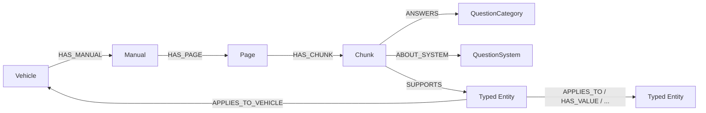

# Neo4j graph yönetimi

CARAGENT graph katmanı iki veri akışını birbirinden ayırır:

1. `ingest` araç, kılavuz, sayfa ve chunk kaynak zincirini yazar.
2. `ingest-extraction` CAR-8 çıktısındaki doğrulanmış entity ve relationship kayıtlarını bu
   kaynak zincirine bağlar.

Chunk'lar CAR-6 soru kategorilerine ve ilgili araç sistemlerine bağlanır. Extraction kayıtları
ortak `CaragentEntity` etiketi yanında domain etiketini de taşır: `CaragentComponentEntity`,
`CaragentSystemEntity`, `CaragentFluidEntity`, `CaragentMaintenanceAction`,
`CaragentWarningEntity`, `CaragentSymptomEntity`, `CaragentTechnicalValue`,
`CaragentFeatureEntity` veya `CaragentRecallEntity`. İlişkiler `APPLIES_TO`, `HAS_VALUE`,
`HAS_INTERVAL`, `WARNS_ABOUT`, `PART_OF`, `REQUIRES`, `INDICATES`, `RESOLVED_BY` ve
`AFFECTS` native Neo4j türleriyle saklanır.



## Kullanım

Önce manifesti graph'a aktarın, sonra aynı chunk kimliklerini kullanan extraction dosyasını yazın:

```powershell
.\.venv\Scripts\python.exe main.py ingest data/processed/toyota-corolla-le-2024.json
.\.venv\Scripts\python.exe main.py ingest-extraction data/processed/entity-extraction.json
```

İkinci komut tüm payload'u önce doğrular ve tek transaction içinde yazar. Entity veya
relationship kimliği tekrar gelirse `MERGE` ile güncellenir; kopya oluşmaz. Kaynak chunk yoksa,
chunk başka araca aitse, endpoint eksikse veya aynı kimlik farklı endpoint/tür/araç için
kullanılmışsa transaction geri alınır.

Graph şemasını chunklarla birlikte baştan kurmak için:

```powershell
.\.venv\Scripts\python.exe main.py rebuild-graph `
  data/processed/toyota-corolla-le-2024.json `
  data/processed/entity-extraction.json
```

Bu komut silme işleminden önce v2 şemasını ve her extraction kanıtının manifestteki yeni chunk
kimliği, araç, sayfa ve URL ile eşleştiğini doğrular. Ardından yalnız `Caragent*` etiketli node'ları
silip kaynak zincirini ve domain grafını yeniden oluşturur.

Her entity `SUPPORTS` bağlantılarıyla kanıt chunk'larına ve `APPLIES_TO_VEHICLE` ile aracına
bağlıdır. Entity üzerinde `type`, kanonik ad, model/yıl, confidence, status, soru kategorileri,
sistemler, öncelik ve tipe özel `attributes_json` tutulur. Kanıtta `page_id`, `page_number`,
kaynak URL ve alıntı korunur. Relationship kanıtı JSON olarak ilişki üzerinde tutulur.

## Bağlantı ayarları

`.env` içinden aşağıdaki değerler yönetilebilir:

- `NEO4J_CONNECTION_TIMEOUT`
- `NEO4J_MAX_RETRY_TIME`
- `NEO4J_POOL_SIZE`
- `NEO4J_ACQUISITION_TIMEOUT`
- `NEO4J_CONNECTION_LIFETIME`

Bağlantı, şema, okuma ve yazma hataları CLI/API katmanına kontrollü `GraphStoreError` olarak
iletilir. `GraphStore` context manager olarak da kullanılabilir ve `close()` tekrar çağrıldığında
güvenlidir.

## Arama ve izolasyon

`GraphStore.search` bütün kullanıcı değerlerini Cypher parametresi olarak geçirir. Arama en az
bir araç, model/yıl veya kılavuz filtresi gerektirir; ayrıca sayfa filtresi uygulanabilir. Her
sonuç chunk, sayfa, kılavuz ve araç kimlikleriyle birlikte kaynak URL, sayfa numarası ve eşleşme
nedenini döndürür. CAR-6 kategori/sistem eşleşmeleri full-text skorunu yükseltir; `NEXT`,
`MENTIONS`, `ANSWERS` ve `ABOUT_SYSTEM` komşulukları bağlam genişletmede kullanılabilir.
Sonuç limiti 1–10 arasındadır.
