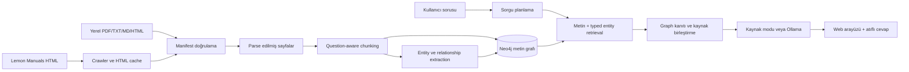
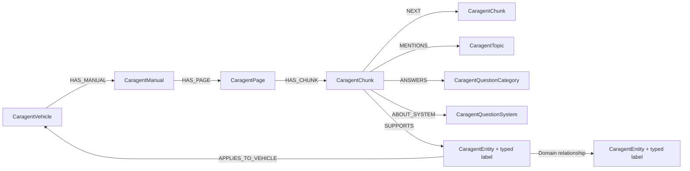

# CARAGENT proje rehberi

Bu doküman CARAGENT'in neyi çözdüğünü, Toyota kılavuzlarından veriyi nasıl hazırladığını,
Neo4j grafını nasıl kurduğunu ve kullanıcı sorularına nasıl kaynaklı cevap verdiğini tek yerde
açıklar. Kurulum yapmak, veri hattını yeniden çalıştırmak veya projeyi geliştirmek isteyenler için
başlangıç noktasıdır.

## 1. Projenin amacı

CARAGENT, Toyota araç kılavuzlarını aranabilir ve kaynakları izlenebilir bir bilgi grafına
dönüştüren yerel bir GraphRAG uygulamasıdır. İlk hedef veri seti **2024 Toyota Corolla LE** için
Lemon Manuals üzerindeki bakım ve onarım sayfalarıdır.

Kullanıcı bir araç seçip doğal dilde soru sorar. Sistem:

1. sorunun niyetini, araç sistemini ve önem seviyesini belirler,
2. yalnız seçili araca ait ilgili kılavuz parçalarını bulur,
3. bilgi grafındaki doğrulanmış entity ve ilişkilerle sonucu genişletir,
4. yanıtı kaynak URL'si ve sayfa bilgisiyle birlikte üretir.

Uygulama internet üzerindeki genel araç bilgilerini cevap kaynağı olarak kullanmaz. Teknik cevap
üretirken ingest edilmiş dokümanlar ve bunlardan çıkarılan graph kanıtlarıyla sınırlı kalır.

## 2. Kapsam ve önemli sınırlar

- Başlangıç veri seti Toyota Corolla LE, model yılı 2024'tür.
- Lemon veri setinde pazar bilgisi belirtilmediği için Türkiye, ABD veya başka bir pazara kesin
  uyumluluk iddiası yapılmaz.
- Donanım paketi, motor tipi, üretim tarihi ve VIN'e göre değişebilen bilgiler kullanıcıya koşullu
  olarak sunulmalıdır.
- `MENTIONS` ilişkisi yalnız bir terimin metinde geçtiğini gösterir; arıza veya neden-sonuç kanıtı
  değildir.
- Görsellerin içindeki yazılar OCR ile okunmaz.
- Geri çağırma uygunluğu yalnız model adına bakılarak kesinleştirilmez; VIN doğrulaması gerekir.
- Yerel Ollama modeli bir bilgi kaynağı değildir. Yalnız retrieval tarafından getirilen güncel
  kanıt paketini doğal Türkçe cevaba dönüştürür.

## 3. Yüksek seviyeli mimari



Sistem beş ana katmandan oluşur:

| Katman | Sorumluluk | Ana dosyalar |
|---|---|---|
| Veri toplama | Lemon sayfalarını indirir, cache ve crawl raporu üretir | `caragent/ingest.py` |
| Veri hazırlama | Manifesti doğrular, sayfaları parse eder ve chunk'lara böler | `caragent/models.py`, `caragent/ingest.py` |
| Bilgi çıkarımı | Typed entity ve yönlü relationship üretir | `caragent/entity_extractor.py` |
| Graph ve retrieval | Neo4j şemasını kurar, ingest ve arama yapar | `caragent/graph.py` |
| RAG ve uygulama | Sorguyu planlar, kaynaklı cevap üretir ve API/UI sunar | `caragent/rag.py`, `caragent/api.py`, `caragent/web/` |

## 4. Uçtan uca veri hattı

### 4.1 Crawl: ham içeriğin alınması

Crawler, verilen Toyota araç kökünün altındaki erişilebilir Lemon Manuals sayfalarını gezer.
`--all` kullanıldığında güvenlik amaçlı sayfa ve ziyaret sınırları kaldırılır; kuyruk bitene kadar
araç kökü altında ilerlenir. Aynı içeriğin büyük bir kopyası olan `Repair and Diagnosis (Single
Page)` bilinçli olarak dışarıda bırakılır.

```powershell
.\.venv\Scripts\python.exe main.py crawl --all `
  --output data/processed/toyota-corolla-le-2024.json
```

Üretilen çıktılar:

- `data/raw/lemon/`: yeniden indirmeyi azaltan ham HTML cache'i,
- `data/processed/toyota-corolla-le-2024.json`: parse edilmiş araç/kılavuz/sayfa manifesti,
- `data/crawl-report.json`: süre, istek, retry, cache hit ve hata bilgileri.

`data/raw/lemon` nihai graph verisi değildir. Kaynağın yerel kopyasıdır; parse işlemi buradaki
HTML içeriğini normalize ederek `data/processed` altındaki JSON manifestine dönüştürür.

### 4.2 Parse ve manifest

Manifest şu hiyerarşiyi korur:

```text
Vehicle
└── Manual
    └── Page
        ├── title
        ├── source_url
        ├── images
        └── text
```

Lemon üzerindeki her bağımsız makale bir `Manual`, makalenin çıkarılmış içeriği ise bir `Page`
olarak modellenir. HTML için görülen `page_number=1`, basılı kılavuzun fiziksel sayfası anlamına
gelmez. PDF ingest işleminde ise sayfa numarası PDF dosyasındaki 1 tabanlı fiziksel sıradır.

### 4.3 Question-aware chunking

Uzun sayfalar retrieval için daha küçük parçalara ayrılır. Varsayılan profil:

| Ayar | Değer |
|---|---:|
| Strateji | `character` |
| Chunk boyutu | 1000 karakter |
| Overlap | 150 karakter |

Karakter stratejisi sırasıyla paragraf, satır, cümle ve kelime sınırlarını korumaya çalışır.
Chunk'lar sayfalar arasında taşmaz. Her chunk kaynak URL'sini, sayfa kimliğini, araç bilgisini,
sırasını ve chunk ayarlarını taşır.

CAR-6 kullanıcı sorusu araştırmasına göre her chunk ayrıca:

- soru kategorileri,
- ilgili araç sistemleri,
- `P0`, `P1` veya `P2` önceliği

ile zenginleştirilir. Bu alanlar retrieval sıralamasına yardım eder; tek başına teknik doğruluk
veya arıza teşhisi sayılmaz.

Chunk çıktısını Neo4j olmadan incelemek için:

```powershell
.\.venv\Scripts\python.exe main.py chunk `
  data/processed/toyota-corolla-le-2024.json
```

### 4.4 Entity ve relationship extraction

Extractor, chunk metinlerinden kontrollü bir JSON sözleşmesine uygun entity ve ilişkiler çıkarır.
Bu aşamada Neo4j'ye yazılmaz.

```powershell
.\.venv\Scripts\python.exe main.py extract `
  data/processed/toyota-corolla-le-2024.json `
  --mode rules `
  --output data/processed/entity-extraction.json
```

Desteklenen entity türleri:

| Tür | Örnek |
|---|---|
| `component` | akü, fren balatası, sensör |
| `system` | fren, direksiyon, şarj sistemi |
| `fluid` | motor yağı, fren sıvısı |
| `maintenance_action` | kontrol, değişim, kalibrasyon |
| `warning` | kaynakta açıkça belirtilen uyarı |
| `symptom` | ikaz lambası, titreşim, ağır direksiyon |
| `technical_value` | basınç, tork, kapasite, süre/mesafe |
| `feature` | Smart Key, CarPlay, sürüş desteği |
| `recall` | geri çağırma veya kampanya kimliği |

Desteklenen yönlü ilişkiler:

| İlişki | Anlamı |
|---|---|
| `APPLIES_TO` | bakım işlemi hangi parça/sistem için geçerli |
| `HAS_VALUE` | entity'nin teknik değeri |
| `HAS_INTERVAL` | bakımın zaman veya mesafe aralığı |
| `WARNS_ABOUT` | uyarının ilgili olduğu konu |
| `PART_OF` | parçanın bağlı olduğu sistem |
| `REQUIRES` | işlemin gerektirdiği değer veya koşul |
| `INDICATES` | belirtinin işaret ettiği parça/sistem |
| `RESOLVED_BY` | belirtinin kaynakta verilen çözümü |
| `AFFECTS` | geri çağırmadan etkilenen parça/sistem |

Her çıkarım birebir kaynak alıntısı ve `chunk_id` ile doğrulanır. Güveni `0.8` altındaki adaylar
`needs_review`, açık eşleşmeler `verified` durumunda tutulur. Kurallı extractor deterministik ve
çevrimdışıdır. `--mode ollama` aynı sözleşmeye LLM yardımıyla aday üretir; sonuç yine şema,
endpoint ve kaynak alıntısı açısından doğrulanır.

### 4.5 Neo4j graph ingest

Ana graph zinciri:



Manifesti ve extraction sonucunu tek akışta yeniden kurmak için:

```powershell
.\.venv\Scripts\python.exe main.py rebuild-graph `
  data/processed/toyota-corolla-le-2024.json `
  data/processed/entity-extraction.json
```

Komut önce extraction sözleşmesini ve bütün kanıt chunk'larını doğrular. Temizleme sırasında
yalnız `Caragent*` etiketli node'lar hedeflenir; aynı Neo4j örneğindeki başka projelerin verileri
silinmez.

Kimlikler deterministik SHA-256 değerleridir. Aynı veri tekrar ingest edildiğinde duplicate node
oluşturulmaz. Bir dokümanın içeriği veya chunk profili değişirse eski sayfa/chunk zinciri tek
doküman transaction'ında yenilenir; hata oluşursa transaction geri alınır.

## 5. GraphRAG soru-cevap akışı

Kullanıcı sorusu aşağıdaki sırayla işlenir:

1. **Araç izolasyonu:** Arama yalnız seçilen `vehicle_id` içinde yapılır.
2. **Sorgu planlama:** Niyet, CAR-6 kategorisi, araç sistemi ve P0–P2 önceliği belirlenir.
3. **Terim genişletme:** Sınırlı Türkçe/İngilizce otomotiv sözlüğü arama terimlerini genişletir.
4. **Metin retrieval:** Neo4j full-text index ilgili chunk'ları bulur.
5. **Typed entity retrieval:** Soruya uyan entity adları ve niyete uygun domain ilişkileri aranır.
6. **Kanıt genişletme:** İlişkinin kaynak chunk'ı ve kontrollü komşuluklar pakete eklenir.
7. **Deduplikasyon:** Metin ve graph sonuçları `chunk_id` üzerinden birleştirilir.
8. **Cevap üretimi:** Kaynak modu alıntıları gösterir; Ollama modu yalnız bu kanıtlardan kısa
   Türkçe cevap üretir.
9. **Citation kontrolü:** Geçersiz veya kaynağı olmayan citation içeren model yanıtı kabul edilmez.

Takip sorularında son kullanıcı konusu aramaya eklenir; eski model cevabı teknik kanıt olarak
kullanılmaz. Güvenlik etkili ve açık kaynak kanıtı bulunan bazı P0 sorguları serbest LLM üretimi
yerine deterministik `evidence_guard` cevabından geçirilir.

## 6. Web arayüzü ve API

Yerel uygulama varsayılan olarak `http://127.0.0.1:8000` adresinde çalışır. Kullanıcı araç seçer,
soru sorar ve cevabın altında kullanılan kaynakları açabilir. Arayüz Neo4j ile Ollama durumunu
ayrı gösterir ve yakın konuşma geçmişini tarayıcıda tutar.

| Endpoint | İşlev |
|---|---|
| `GET /api/health` | Neo4j, cevap modu ve Ollama hazırlık durumu |
| `GET /api/vehicles` | Ingest edilmiş araçları listeler |
| `GET /api/stats` | Graph node, ilişki ve kategori özetleri |
| `GET /api/graph/{vehicle_id}` | Seçili aracın doküman/chunk önizlemesi |
| `POST /api/ask` | Kaynaklı soru-cevap ve orkestrasyon özeti |

Swagger/OpenAPI ekranı: `http://127.0.0.1:8000/docs`

## 7. Kurulum ve ilk çalıştırma

Gereksinimler:

- Python 3.12,
- kullanıcı tarafından oluşturulmuş proje içi `.venv`,
- Docker Desktop,
- Neo4j için ayrılabilecek yerel bellek ve disk alanı.

Windows PowerShell:

```powershell
.\.venv\Scripts\python.exe -m pip install -r requirements.txt
.\.venv\Scripts\python.exe main.py setup --pages 12
.\.venv\Scripts\python.exe main.py enable-llm
.\.venv\Scripts\python.exe main.py serve
```

`setup`, `.env` ayarlarını hazırlar, Neo4j'yi başlatır, şemayı kurar ve sınırlı başlangıç verisini
ingest eder. `enable-llm`, Ollama konteynerini ve varsayılan `qwen2.5:3b` modelini hazırlar.
Model kullanılmayacaksa sistem `sources` modunda yalnız bulunan kaynakları gösterebilir.

Servisler:

| Servis | Adres |
|---|---|
| CARAGENT UI | `http://127.0.0.1:8000` |
| API dokümanı | `http://127.0.0.1:8000/docs` |
| Neo4j Browser | `http://127.0.0.1:7474/browser/` |
| Neo4j Bolt | `bolt://127.0.0.1:7687` |
| Ollama API | `http://127.0.0.1:11434` |

Neo4j kullanıcı adı `neo4j`, parola yerel `.env` içindeki `NEO4J_PASSWORD` değeridir. Gizli
bilgiler Git'e eklenmez.

## 8. Neo4j'de grafı inceleme

### Sade ingest grafiği

Önce `main.py vehicles` çıktısından araç kimliğini alın ve aşağıdaki `<vehicle_id>` alanına yazın:

```cypher
MATCH p=(vehicle:CaragentVehicle {id: '<vehicle_id>'})
  -[:HAS_MANUAL]->(manual:CaragentManual)
  -[:HAS_PAGE]->(page:CaragentPage)
  -[:HAS_CHUNK]->(chunk:CaragentChunk)
WITH p, chunk
LIMIT 8
OPTIONAL MATCH q=(chunk)-[:SUPPORTS]->(entity:CaragentEntity)
RETURN p, q
LIMIT 20;
```

Bu sorgu `Araç → Kılavuz → Sayfa → Chunk → Entity` akışını okunabilir sayıda node ile gösterir.

### Doğrulanmış domain ilişkileri

```cypher
MATCH p=(source:CaragentEntity)-[r]->(target:CaragentEntity)
WHERE source.vehicle_id = '<vehicle_id>'
  AND target.vehicle_id = source.vehicle_id
  AND r.status = 'verified'
  AND type(r) IN [
    'PART_OF', 'WARNS_ABOUT', 'INDICATES', 'RESOLVED_BY',
    'REQUIRES', 'AFFECTS', 'APPLIES_TO', 'HAS_VALUE', 'HAS_INTERVAL'
  ]
RETURN p
LIMIT 100;
```

Bu sorgu yalnız kaynakla doğrulanmış entity-to-entity bağlantılarını gösterir.

### Graph sayıları

```cypher
MATCH (n)
WHERE any(label IN labels(n) WHERE label STARTS WITH 'Caragent')
RETURN labels(n) AS labels, count(*) AS total
ORDER BY total DESC;
```

## 9. Sık kullanılan komutlar

```powershell
# CLI yardımı
.\.venv\Scripts\python.exe main.py --help

# Neo4j şemasını oluştur/doğrula
.\.venv\Scripts\python.exe main.py init

# Araçları ve graph istatistiklerini göster
.\.venv\Scripts\python.exe main.py vehicles
.\.venv\Scripts\python.exe main.py stats

# Terminalden soru sor
.\.venv\Scripts\python.exe main.py ask "Motor yağı ne zaman değiştirilmeli?" `
  --vehicle <vehicle_id>

# Web uygulamasını çalıştır
.\.venv\Scripts\python.exe main.py serve
```

## 10. Proje dizinleri

```text
CARAGENT/
├── caragent/
│   ├── api.py                 # FastAPI endpoint'leri
│   ├── cli.py                 # Komut satırı arayüzü
│   ├── config.py              # .env ve çalışma ayarları
│   ├── entity_extractor.py    # Entity/relationship extraction
│   ├── graph.py               # Neo4j şeması, ingest ve retrieval
│   ├── ingest.py              # Crawl, parse ve chunklama
│   ├── models.py              # Veri modelleri ve doğrulama
│   ├── rag.py                 # Sorgu planlama ve cevap üretimi
│   └── web/                   # Tarayıcı arayüzü
├── data/
│   ├── raw/                   # Git dışı ham HTML cache'i
│   ├── processed/             # Git dışı manifest/extraction çıktıları
│   └── examples/              # Küçük örnek ve değerlendirme verileri
├── docs/                      # Mimari ve özellik dokümanları
├── tests/                     # Birim ve Neo4j entegrasyon testleri
├── compose.yaml               # Neo4j ve Ollama servisleri
├── main.py                    # Uygulama giriş noktası
└── requirements.txt           # Çalışma zamanı bağımlılıkları
```

## 11. Test ve kalite kontrolleri

```powershell
.\.venv\Scripts\python.exe -m pip install -r requirements-dev.txt
.\.venv\Scripts\python.exe -m pytest -q
```

Gerçek Neo4j entegrasyon testleri için Docker/Neo4j açıkken:

```powershell
$env:CARAGENT_INTEGRATION="1"
.\.venv\Scripts\python.exe -m pytest -q
```

Testler; manifest doğrulama, HTML parse, chunk sınırları, entity sözleşmesi, transaction geri alma,
araç izolasyonu, retrieval, citation doğrulama ve API girdilerini kapsar.

## 12. Tasarım kararlarının özeti

- **Kaynak önce gelir:** Her teknik bilgi chunk ve URL seviyesinde izlenebilir olmalıdır.
- **Graph ve metin birlikte kullanılır:** Graph anlamlı ilişkileri, chunk ise cevabın özgün kanıtını
  taşır.
- **Araç izolasyonu zorunludur:** Başka model veya yılın bilgisi retrieval sonucuna karışmaz.
- **Deterministik kimlikler kullanılır:** Pipeline güvenli şekilde tekrar çalıştırılabilir.
- **Şema kontrollüdür:** Serbest LLM çıktısı doğrudan veritabanına yazılmaz.
- **Yerel çalışma varsayılandır:** Neo4j, Ollama, API ve UI kullanıcının bilgisayarında çalışır.
- **Belirsizlik korunur:** Kaynak yetersizse sistem bilgi uydurmak yerine bunu açıkça belirtir.

## 13. Ayrıntılı dokümanlar

- [Mimari](architecture.md)
- [Chunklama](chunking.md)
- [Entity extraction](entity-extraction.md)
- [Neo4j graph yönetimi](graph.md)
- [CAR-5 ingest parametre raporu](ingest-parameter-report.md)
- [CAR-6 kullanıcı sorusu araştırması](user-question-research.md)

